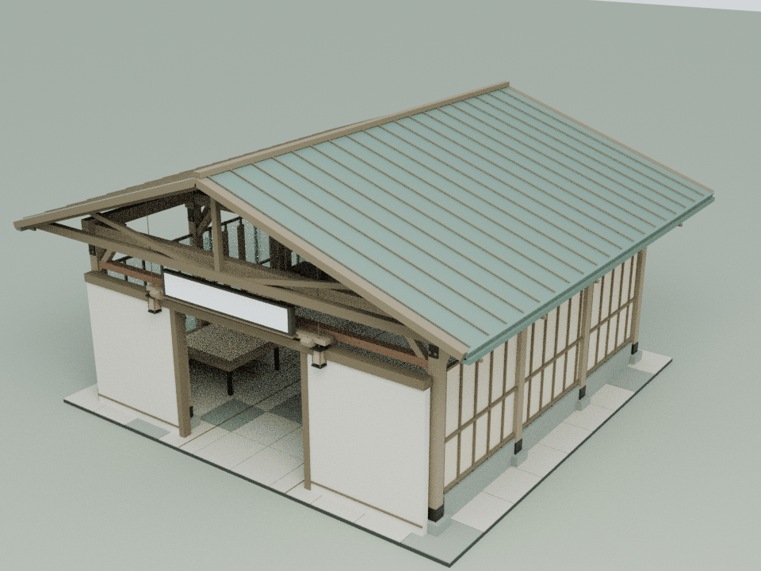
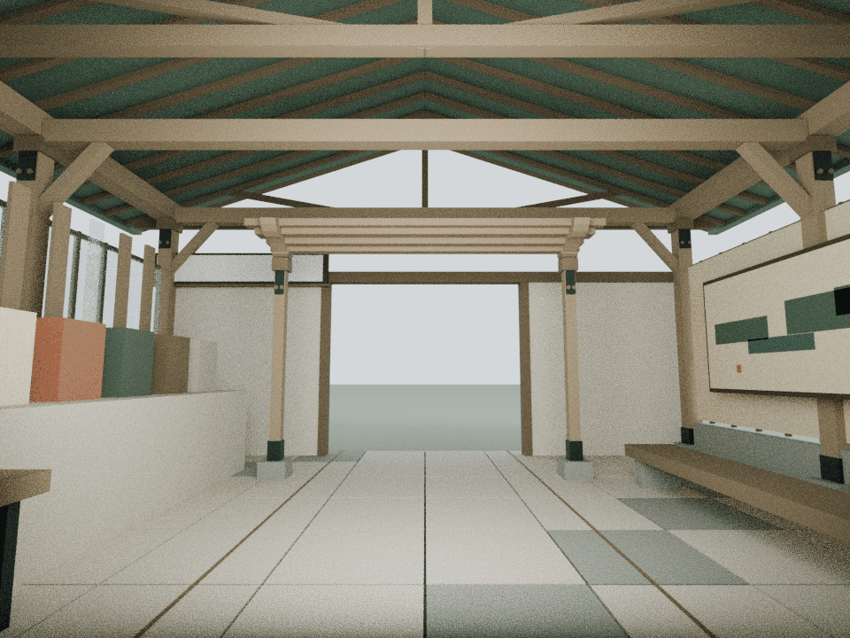
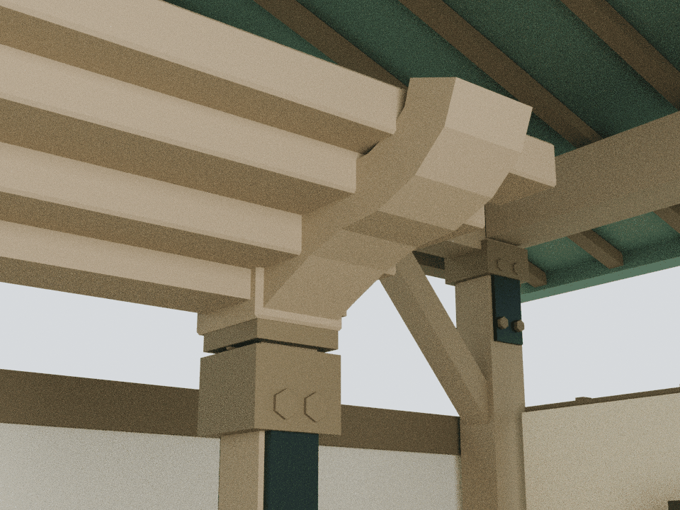

# 画韵另一入口：双重门廊与共同长卷

本轮仅细化 building2，基于已发布的 `c253173019253961ea94f5b25b1bc7c8f6914266`。实际内容由最终生产加载顺序中的 `assets/content-creation-care.js` 提供；`assets/readings/2.json` 的三个阅读章节说明，它是画韵新生的另一处公开入口，没有独立历史馆藏的证据。原导航标题、URL与全部正文不变。

## 内容与构造

原建筑用较小的双重门廊、共同长卷和五种媒介样本，表达同一内容从另一道门被看见。本轮强化门廊深度与檐下构造接合，让次入口具有自己的轮廓，同时保持相对主馆的较小规模。

原侧窗的九片滤光构件继续平移，长卷和样本展示保持完整可见；不新增弹窗、文字或灯光。本轮不将“旧址”导航名称演绎成废墟、档案库或另一套馆藏。

## 模型与重建

    blender -b -t 2 --python tools/model-alternate.py
    node docs/alternate-detail-check.cjs
    node docs/alternate-regression.cjs
    blender -b -t 4 --python tools/render-alternate.py

新增22个闭合实体、1,016三角面，仅橡木与铜色2个共享批次。两座原门廊各有三层叠口、成对卷形托臂、真实空心柱套和短承肩；东西两侧檐口另有连续座条与收边。全部构件座落原柱或原框梁，不以悬空装饰替代真实接合。

真实 Blender 三角网格由 `assets/alternate-detail.js` 接入建筑2。原布局完成后再附加细节并更新实际包围盒，不改变地面尺寸和阅读位置。可编辑模型、运行时装配与检查报告留在本地 `qa-results/alternate/`，仓库保留生成脚本、运行时网格和三张压缩审阅图。

## 检查与限制

独立审计恢复22个闭合流形实体，1,280条截面射线核对实际构件；35处有限体积接合将新增构件连接到原柱梁，并向原石脚核对接合链。原底层门楣与新叠口的同宽端面风险，在图审冻结前通过将新底层宽度改为5.24 m消除，每端形成20 mm真实错台。7,469,632对新旧面与81,568对新增面检查均没有正面积共面重叠。

514个原网格/实例、49个碰撞体、原材质、组、灯光、文字和动作在8个姿态逐值保持。九片滤光构件全行程保留25 mm新增构件净距；55处屋顶构件、4片原玻璃、4个文字面视域、长卷与五种媒介样本均检查。完整2.4 m身体空间完成50,208次三角与294次碰撞检测，三个阅读章节保持不变。

整院59项显式CPU检查全部通过，402项源哈希在执行期间稳定；117份JS/CJS、47份Python AST和39段HTML内联脚本语法通过，172项独立来源保全通过。最终生产顺序中全部22馆精修组各挂载一次，原21馆预算逐栋不变；月雪91实例的1 mm铺地修复与匿名阅读保持。75项发布manifest、两入口各54项缓存版本一致。

本轮资产79,422字节原始 / 9,946字节gzip-9；累计22馆新增152,552三角面 / 139批次，整栋装配合计520,456三角面 / 1,100批次。22馆detail合计9,430,237字节原始 / 1,012,292字节gzip-9。B2原实际装配7,324面 / 40批次，本轮后8,340面 / 42批次；原远距LOD节省7,568面 / 60批次保持。检查采用云端明确列出的CPU测试，不运行Mac导航脚本或浏览器。图为真实运行时装配的Blender CPU审阅，室内使用仅供审阅的柔和补光以看清接合；运行时灯光没有增加。当前Blender不支持OpenImageDenoise，采用原有32次采样而未安装组件。Canvas文字纹理未烘焙；文字由内容与Canvas回归验证，不替代浏览器交互、GPU帧率测试或实体结构认证。

