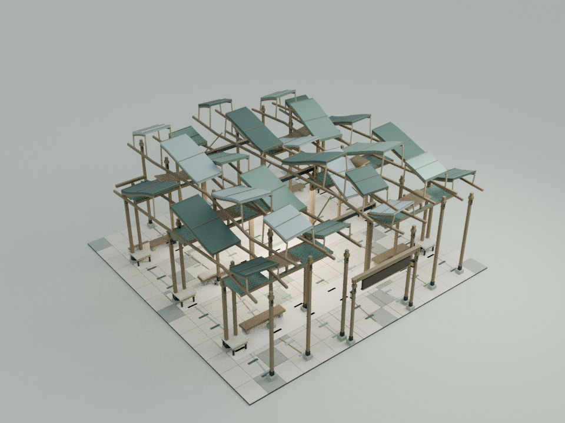
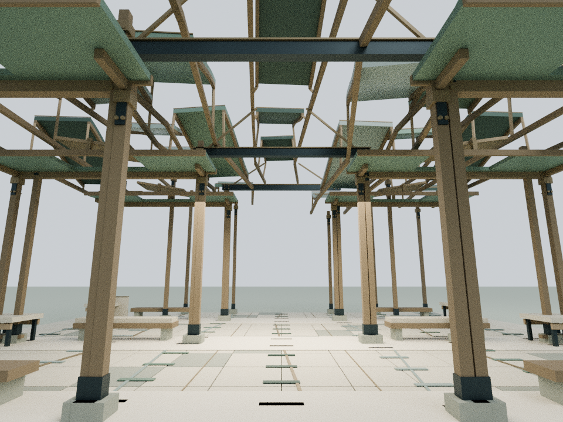
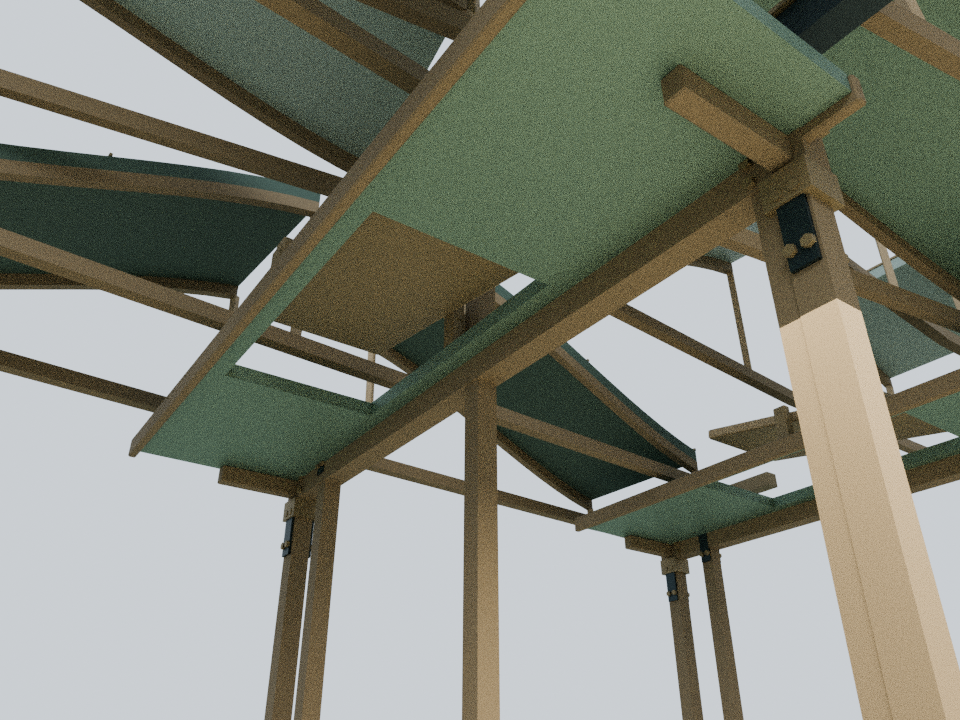

# 从因到果：七条起伏屋带，三个共同庭

本轮只细化 building15，以已发布的 `8038643428fc5ab0a51328bb53e3871ad6d1eab9` 为基线。内容依据庭院已有的 `assets/readings/15.json` 和建筑来源说明。七条生活线在三个实际共同庭处互相影响；社团支线在最后一个结附近结束，其余六条继续。建筑是对原文的空间解释，没有增加人物判断或新的因果结论。

## 内容与构造

- 七条屋带沿用原有平面折线、宽度、起点及0.98 m端部退让；27片闭合屋壳替换原薄盒屋片，起伏沿长度平滑变化，横向仍保持清晰的带状截面
- 屋壳竖向厚度16 cm；两个木质边层贴合下皮，短木腹杆把抬高的屋带接回原结构边梁，铜立缝随屋带高度变化
- 三处结点仍是真正可停留的横向共同庭，保留原坐席、桌面、地面纹理、中轴、横向出口和全部原柱
- 第七条的屋盖仍在最后一个结前收口，原结构边梁、终端实体及地面支线全部保留，没有延长成第七条贯通路线
- 六个借光活动节点保留原玻璃材质、局部构造方式与转动公式；新增木框和铜轴套挂在各自原节点上，几何缓存共享而节点独立
- 为消除原玻璃和固定构件穿插，六片原实心横庭顶板改为有真实开口的四边框；六个活动安装点提高12 cm并向入口偏移95 cm，六片玻璃宽度统一由2.8 m收至2.2 m，外框总宽2.30 m，固定开口宽2.60 m。原柱和原横梁保持，固定轴座与新增短悬臂配合新的安装位置
- 允许的源码变化严格限定为27片屋带及其水平表面铜条、六片固定顶板的开口替换、六个安装点的精确平移与玻璃宽度修正，以及两个细化挂接点。低位展陈、阅读正文和机构转角公式不变

## 模型与重建

屋带高度采用：原带高 + 0.20 + 1.65 × (0.5 + 0.5 × cos(π × z / 6 + 奇偶带相位))。每片采用12个纵向分段、上下两层和完整侧边、端盖；三个结两侧留有真实屋带天光缝。该表达保持原平面关系，没有把七条线变成七彩装饰。

    blender -b -t 2 --python tools/model-causal.py
    node docs/causal-detail-check.cjs
    node docs/causal-regression.cjs
    blender -b -t 4 --python tools/render-causal.py

Blender静态装配为331个构件，活动原型为6个构件并复用六次；细化资源共18,092个三角面、18个材质批次，文本1,180,602字节，gzip约145 KB。这是细化资源面数，不是删除旧屋片后的净增面数。另有24片运行时固定开口边框。

`CourtyardCausalDetail.attach(b)` 把静态装配挂到建筑根节点；`attachVent(b, parent)` 把活动原型挂到六个原借光节点。细化资源先于 `content-narratives.js` 加载。可编辑源为 `qa-results/causal/causal-detail.blend`；`runtime-assembly.json` 导出1,265个实际运行时网格/实例，用于CPU审阅装配。仓库保留生成、验证和渲染脚本及审阅图，本地模型与临时测试结果不提交。

## 验证范围

验证脚本使用实际Three.js装配，既验证新增网格，也与只删除获准屋片/铜条/固定顶板并应用精确安装点平移与叶片宽度修正的隔离基线逐值比较：

- 网格坐标及法线有限，没有退化三角面，细化资源低于20,000三角面预算
- 从实际屋面材质网格分离27个独立闭合实体，每片100个三角面、52个顶点、150条边；每条边反向使用两次，实体体积为正
- 实际顶点逐一匹配独立计算的原平面折线、0.98 m退让、指定起伏公式和16 cm竖向厚度，不仅检查生成器元数据
- 810条屋片上下射线验证厚度及采样高度；324条射线验证木边层贴合屋盖下皮；693条射线确认三个屋带天光缝保持开放
- 六个活动节点在八个反复状态中保持原转角公式和刚体比例，48个活动包围盒最低5.664 m；345,600次活动三角面与固定开口边框的精确相交检查、58,500次与邻近原构件的保守实体检查通过。另有3,169,536次活动玻璃/木框与全部新增固定构件的实际三角面包围盒检查通过；铜轴与轴座的设计接触不计为穿插
- 592个原低位网格/实例（含展陈）逐值对比未修改基线；1,223个保留或明确修正安装尺寸的原网格/实例逐值对比隔离基线，覆盖八种状态
- 原碰撞列表完整保持；12条完整通行线按0.38 m身体半径检测，含663个中轴样点、1,899个横庭通道样点，2,562条实际装配射线检查低位净空
- 其他24栋标准建筑、3栋基础设施、全部原机构和机械蝶保持；阅读JSON、阅读面板、建筑动作和庭院运行代码字节保持
- 全入口源码只允许新增细化脚本和缓存版本；58项发布清单与37个入口缓存版本逐一校验，两份入口完全一致
- 27项可运行Node脚本中26项通过；唯一失败为基线已有的 `wave1-check.cjs` 旧LINKS哈希断言，发生在浏览器启动前。本轮LINKS与已发布基线一致
- 25个资产JavaScript文件和78段入口/验证页脚本语法通过，`git diff --check` 通过；另两项依赖Mac Chrome的导航脚本明确未运行

浏览器GPU、真实触控、手机帧率和线上完整交互未经本轮实测。已确认的浏览器权限限制没有被绕过；两项依赖Mac Chrome的导航脚本不运行。`docs/causal-detail-qa.html` 是后续独立Three.js装配审阅入口，不代表浏览器验收已完成。

下列图片是Blender CPU审阅图，并非网站截图。文字Canvas与木纹贴图未烘焙；图片用于检查屋带节奏、共同庭、活动构造与空隙，不构成实体结构承重或设备安全认证。

