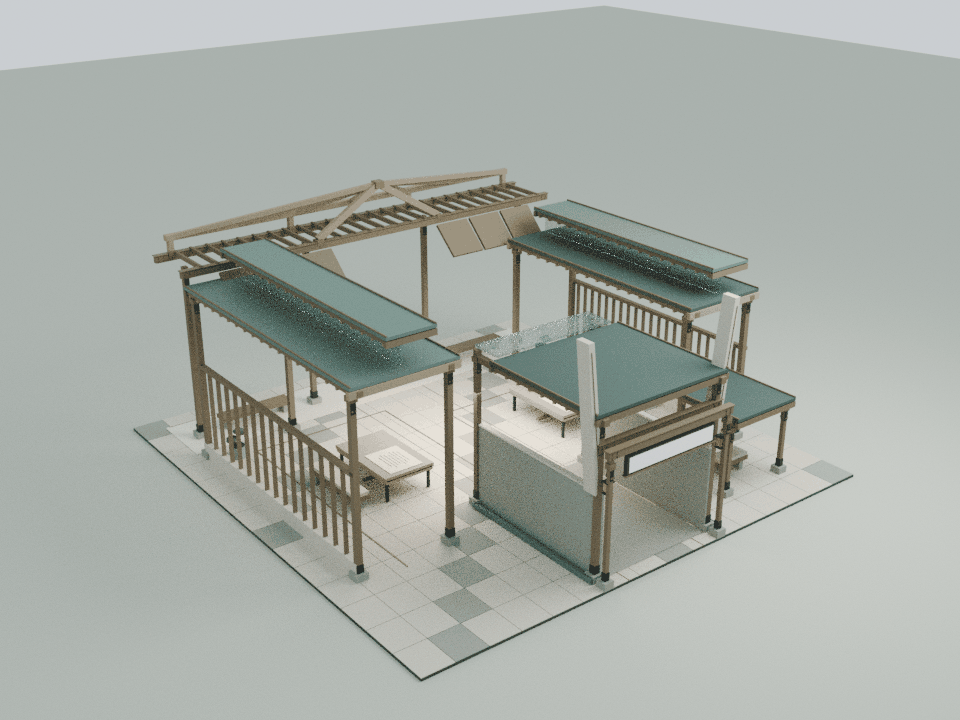
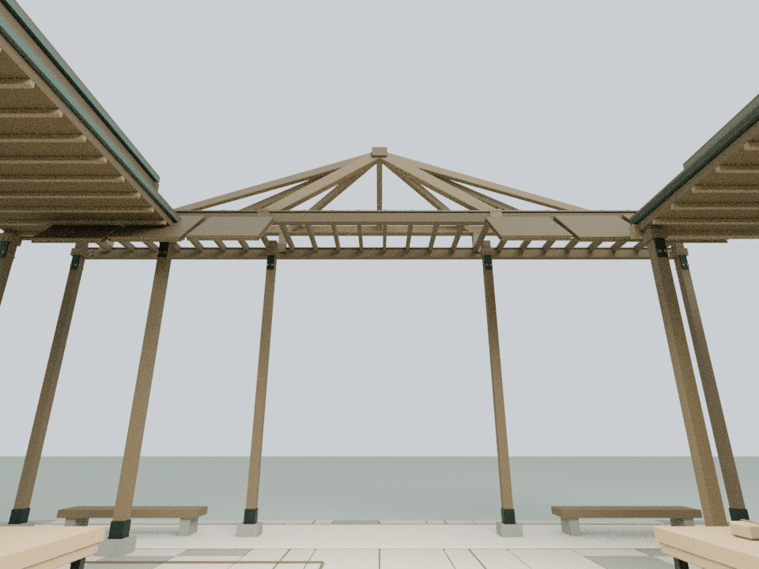
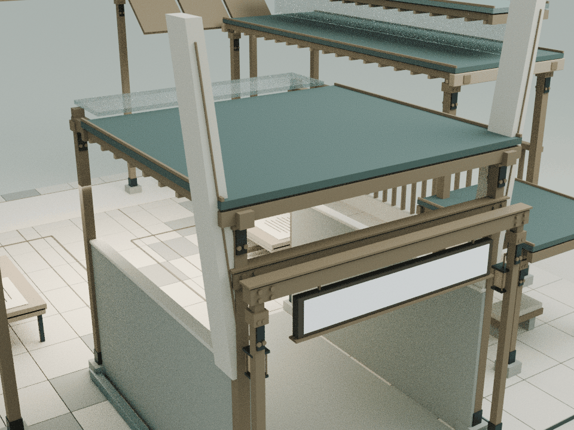

# 一个爱哭的城市：从雨巷到晴天的三次回返

本轮仅细化 building16，基线为已发布的 `8f0019ef17669f3277a8b99c675b7cf4f2cfbf52`。内容依据 `assets/readings/16.json`：三次南京往返，由陌生的雨中抵达，经由共同创造，走向晴天与回赠。设计保留原雨巷、独坐席、共享工作庭、三条回返线以及向晴天抬起视野的原百叶。

## 内容与构造

- 雨巷入口两片渐收、向外微倾的石刃从原石墙顶延伸，顶高8.75 m；窄铜嵌线与原排水槽呼应，没有加入雨粒子
- 两条回廊保留不同宽度与高度，补充木质檐口和接合板，东侧后端为原百叶的活动范围留空；共享工作桌新增薄围板，不扩大原占地
- 原文中的三盒回赠礼物落实为共享桌上的三个小木盒，放在原纸张之外；没有添加虚构标签或新的故事结论
- 晴天出口采用七根稀疏放射木肋，汇聚于9.6 m高的接点，由两根V形撑与后侧集梁支承。原开放木架完整保留，肋间仍然通透，出口没有变为实心屋顶
- 六片原活动百叶的几何、材质与运动规律保持；本轮没有复制六套活动附件，所有新增构件仅用三个静态材质批次

## 模型与重建

    blender -b -t 2 --python tools/model-city.py
    node docs/city-detail-check.cjs
    node docs/city-regression.cjs
    node docs/detail-lod-check.cjs
    blender -b -t 4 --python tools/render-city.py

Blender装配共50构件、2,136三角面、3个材质批次，gzip约15KB。两个闭合石刃使用真实渐收四边形截面，七根放射木肋与V撑均为闭合倒角实体；运行时采用同一Blender三角网格，按木、石、铜合批并共享缓存。

源码只增加 `CourtyardCityDetail.attach(b)` 一个挂接点。静态轮廓保持远处可见，既有次要活动附件远距LOD不变。本地可编辑源为 `qa-results/city/city-detail.blend`，实际运行时CPU装配为 `city-runtime-assembly.blend`；模型、导出与临时测试记录不提交。

## 验证与预算

- 两个闭合石刃各8顶点、12三角面、18条边；七根放射肋及两根V撑各24顶点、44三角面、66条边，实际网格独立验证端点、倒角轮廓和正体积
- 八个往返状态下890个原网格/实例逐值保持，其中507个低位构件保持；六片原百叶与所有新增固定三角面净空通过
- 中央通道与三条原回返折线路径按0.38 m身体半径做连续验证，985条头顶净空射线通过
- 三个实际文字平面的600条视线及原完整纸面的400条视线通过，阅读内容和原碰撞列表保持；其他馆、机械蝶与既有远距LOD保持
- 发布清单63项哈希、42个入口缓存版本逐项核验，68个资产JS与验证CJS文件、24段非空内联脚本语法通过，36项可运行整院检查中35项通过，唯一失败为已核对的基线wave1旧LINKS哈希断言，发生在浏览器启动前；两项Mac Chrome导航脚本未运行

累计面数、批次、资源和远距减负数据见 `DETAIL_PERFORMANCE_BUDGET.md`；这些是装配预算，不是手机实测帧率。

浏览器GPU、真实触控与手机帧率未实测；两项Mac Chrome导航脚本未运行，既有浏览器权限限制未绕过。

下图为实际运行时装配导入Blender的CPU审阅图，并非网站截图；Canvas文字与木纹贴图未烘焙，用于检查轮廓、通路与构件间隙，不构成实体结构认证。

