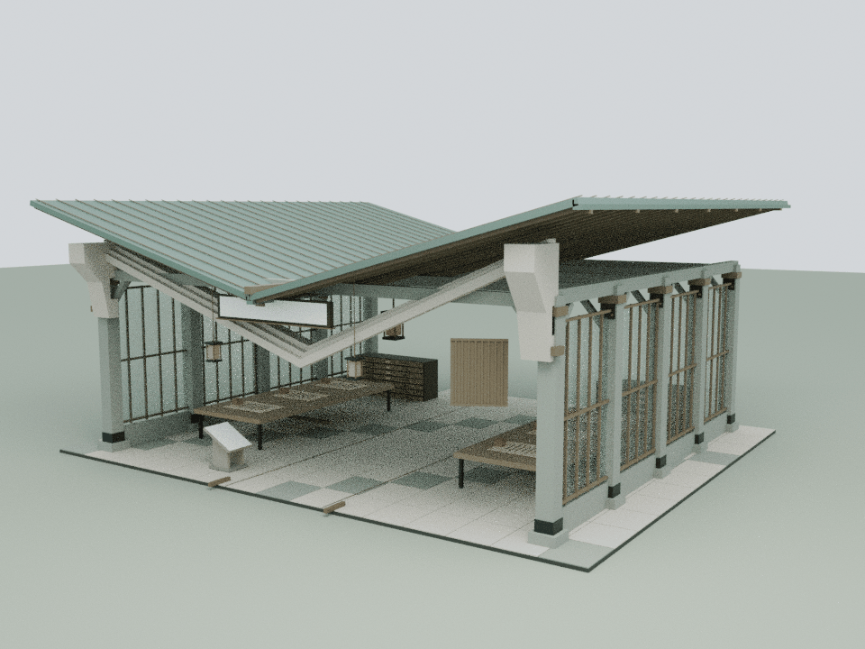
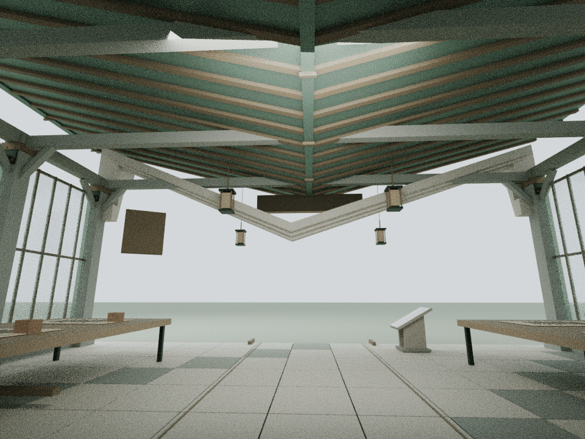
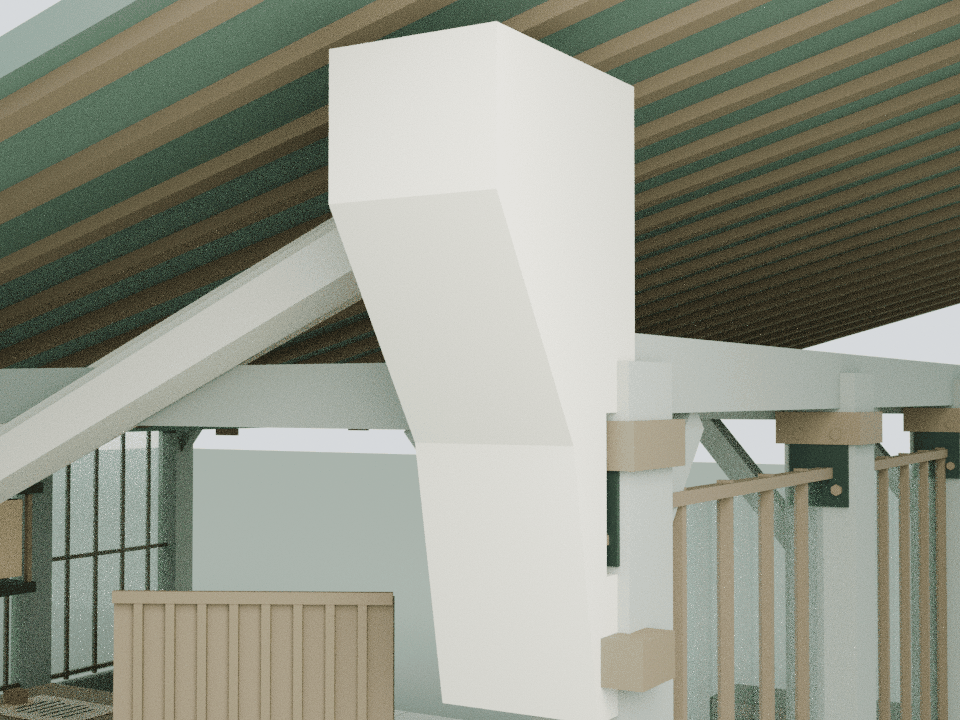

# 知虾标书：展开册页式入口构架

本轮仅细化 building11，基于已发布的 `e531f775926dc5d24e3b2d063e542d872b655481`。最终生产路径仍是 `assets/architecture.js` 的双坡文档馆，服务内容脚本没有覆盖此馆。

## 内容与边界

`assets/readings/11.json` 的三个章节只收录公开产品定位与登录边界：知虾将自身介绍为 AI 投标文档编制平台，但本次没有访问登录后的编制、审阅或导出界面。本轮以册页的折线、叠层与接合为建筑表达，不把造型当作经过验证的业务流程。

保留原家具、纸面、来源链接及内嵌文字，不新增虚构标书、账号输入或自动审查功能。没有读取招标材料、模板库、项目数据或提交投标；也没有恢复与本轮建筑无关的已取消任务。

## 模型与审阅

生成脚本、实际运行时网格与三张压缩审阅图随仓库保存；可编辑 Blender 源与完整运行时装配留在本地 `qa-results/dossier/`。离线装配不烘焙Canvas文字像素，文字由源文件与绘制回归核对。CPU审阅不替代浏览器交互、GPU性能或实体结构认证。

## 构件与重建

    blender -b -t 4 --python tools/model-dossier.py
    node docs/dossier-detail-check.cjs
    node docs/dossier-regression.cjs
    blender -b -t 4 --python tools/render-dossier.py

新增7件闭合正体积构件、188三角面、2个缓存原材质批次。三层折线石框、两块阶状承肩和两件开背铜色承座形成册页式入口。最低新增几何3.62 m，保持3.6 m中央通路。承肩背面有真实凹口，露出原柱帽、钢箍和螺栓。

初稿被独立审计发现会影响近门题牌视域并穿过旧灯吊线。最终保持折线高度、将层次收至题牌和吊线后方：主层z为[-7.13,-6.70]，中层[-7.32,-6.96]，前层[-7.48,-7.17]，总深度780 mm。全部层位于题牌后方至少401 mm。只调整新增构件，没有移动题牌、灯或观察点来回避问题。

## 验证

683个原网格/实例、40个碰撞体、8个姿态、原Canvas文字与三个阅读章节精确保留。全部旧非承托部件没有新增交叉或包埋；接合限定到9个按实际位置和尺寸识别的原石构件，形成16处有限体积承托，不按材质泛化放行。全部新组件无自交及意外正面积共面重叠。

12件原柱帽、钢箍、螺栓保留35 mm净距；36件原灯具/吊线保持至少61.75 mm，原四根吊线端点与屋面三角形接合不变。题牌背板净距269.66 mm、底边240 mm，原近门完整视锥通过。屋面净距314.52 mm、玻璃150 mm；11个原百叶构件的全行程连续扫掠保持25 mm余量。完整2.4 m人体、阅读停点及两块文字面视域通过。

模型重建输出与完整运行时装配验证一致。新增没有动画、运行时灯光或用户输入。三张最终审阅图经实际像素查看，保留原通行和陈设。

本馆从9,230面 / 33批次变为9,418面 / 35批次，新增资产20,434字节原始 / 4,043字节Node gzip-9。前24馆预算逐栋不变；全馆覆盖与合计口径见 `COURTYARD_DETAIL_COMPLETION.md`。

整院65项明确列出的CPU检查全部通过；127份JS/CJS、53份Python AST与42段HTML内联脚本语法通过，181项独立来源保全通过。434份源文件和10份模型/渲染产物冻结核对；运行期间仅两份总结Markdown变化。78项发布manifest、两入口各57项缓存版本一致。25普通馆与独立蝴蝶实际最终加载覆盖无遗漏、无重复挂载。
