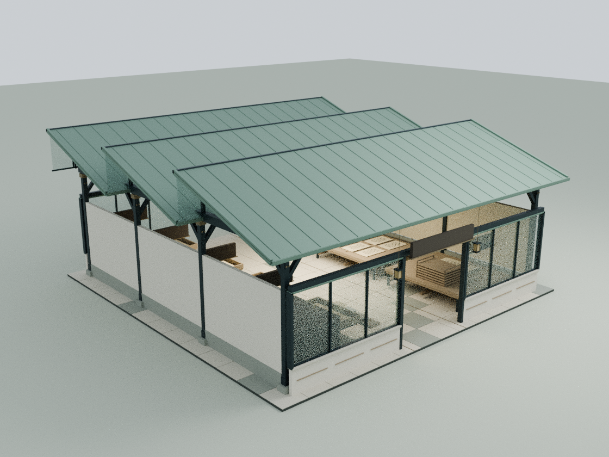
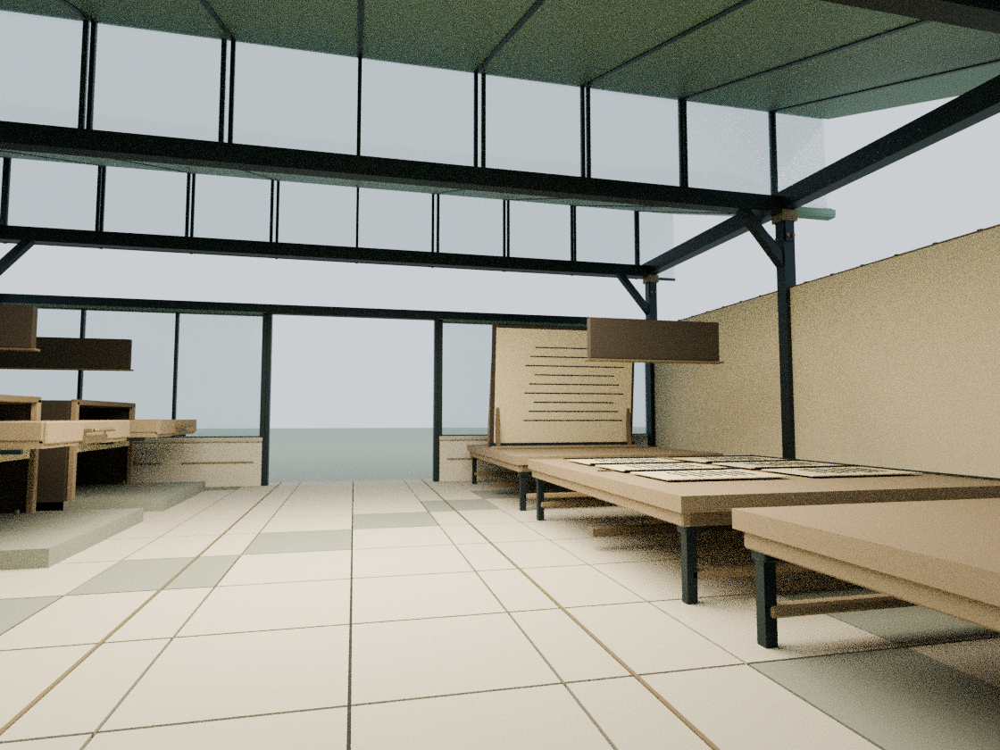
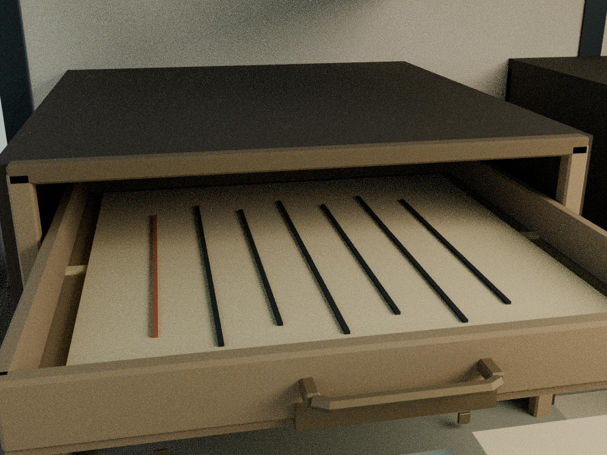

# 排版助手工作坊：从输入到校样

本轮只细化 building6。基线包含已发布的两栋暖聆与机械蝶自动飞行，实际生产 main `386c2b123a5a30e785714aec22a354f998af03d9` 已合入。

## 内容与建筑

依据庭院已有公开内容记录 `assets/readings/6.json`：公众号编辑流程分为输入、编辑、预览；右侧四种刊发情境是日常、三下乡、寒假实践、转载。保留这些文字与原交互，不把数字编辑工坊改写成未经来源支持的实体印刷厂。

- 三段锯齿采光屋顶增加折边、立缝、窗压条、谷部排水槽和深窗洞收口
- 三段木桌增加围边、连接件和低位撑杆；输入台增加资料架立柱，编辑台加入不遮挡样张的定位刻线
- 完整校样板改为轻微倾斜，并有对应A形支撑；保留原整幅示意内容
- 四个模板柜由实心盒体改为开放柜体，抽屉不会再从整块实心几何里穿出
- 抽屉侧板、前后板、滑轨和拉手挂在原有四个活动节点上，保持原运动函数与错峰节奏
- 新拉手的完整扫掠范围由实体柜台基座保护；基座向通路方向只延伸9cm，仍完全处于侧湾，中轴通行未变化

## 实际模型

`tools/model-editor.py` 在 Blender 建模227个静态构件和一个9构件的活动抽屉原型，原型在运行时被4个抽屉共享。最终新增11,572三角面、22个材质批次，资源gzip约63KB。活动几何共享缓存，不能与原运动节点脱离。

    blender -b -t 2 --python tools/model-editor.py
    node docs/editor-detail-check.cjs
    node docs/editor-regression.cjs
    blender -b -t 4 --python tools/render-editor.py

本地可编辑源为 `qa-results/editor/editor-detail.blend`。静态部分与活动原型有 `runtime_section` 属性区分。完整装配 `editor-runtime-assembly.blend` 由实际Three.js网格/实例矩阵导出，展示四个抽屉展开状态。模型不进入Git，仓库保留重建脚本和审阅图。

## 验证

- 新几何坐标有限、无退化面；中心三条行走线按0.38m角色半径检查，新增结构实际射线净高检查
- 四个抽屉8种反复切换状态；核对原运动公式、侧墙/柜顶间隙、拉手始终在保护基座范围内
- 四个抽屉复用同一组Blender原型几何，且各自挂在原活动节点下
- 其余24栋标准建筑实际几何与App候选基线逐值一致，全部原机构名称保持
- 全庭28栋几何，暖聆屋壳、App图形可见性、机械蝶飞行、阅读/铭文、月雪、手机布局源码等回归
- 20项脚本检查中19项通过；唯一失败为已在生产基线复现的旧 `wave1-check.cjs` LINKS哈希断言，本轮没有修改LINKS
- 两份入口一致，54项发布资源哈希同步并逐项检查

浏览器GPU与真实手机未实测，未绕过已确认的Chromium socket权限限制。审阅图是Blender CPU补光渲染，文字Canvas与木纹贴图未烘焙，不是网站截图。本模型没有进行结构承重或实际设备安全认证。

## 内部审阅图

