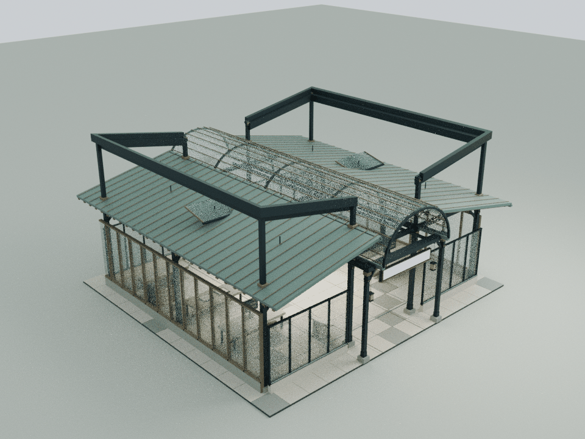
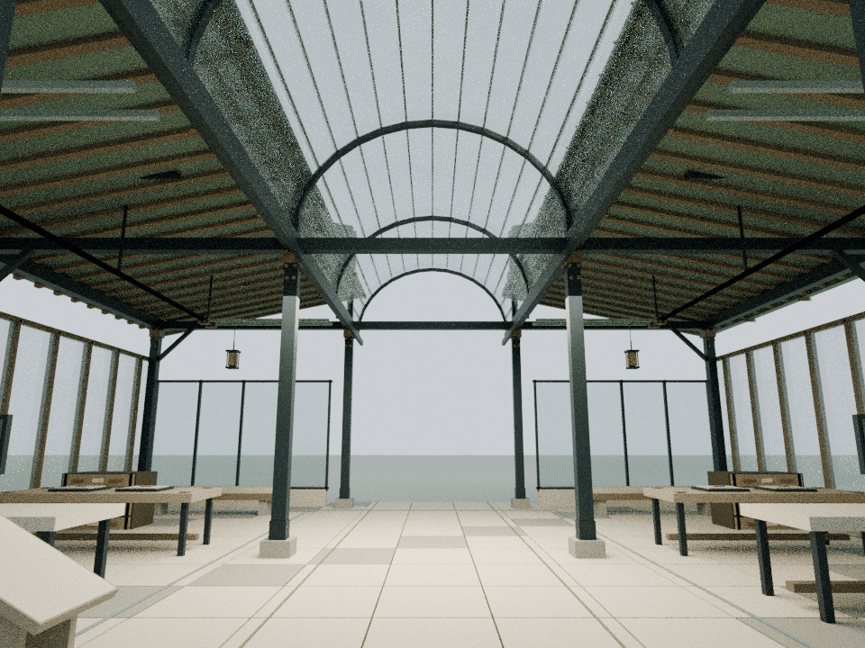
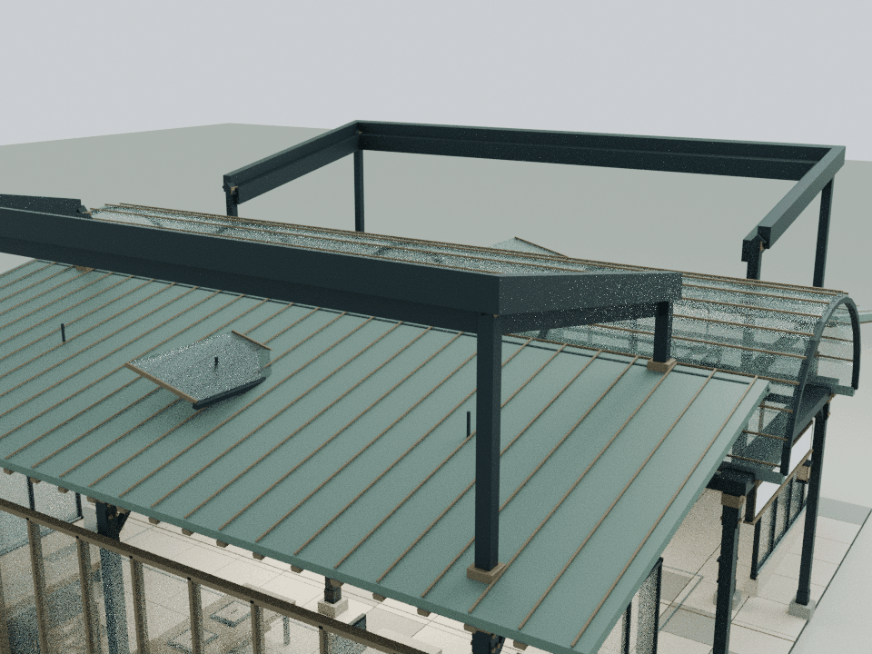

# API馆：双路由翼架

本轮仅细化 building10，基线为已发布的 `02a7f4077e18f35483457b55d303bc409dfcf808`。依据 `assets/readings/10.json` 中统一入口、两个等位模型路由和各自两类兼容端点的说明。目录观察日期仍为2026年10月9日，不据此声称当前可用性或上游模型身份；原缺省性能横线保持，不生成实时健康状态。

## 内容与结构

- 两侧等位模型室上方各出现两条可沿结构追踪的U形钢箱梁，形成对称双路由翼架，沿原两室外缘分流，再回到中央入口/观察轴两端
- 箱梁为完整闭合实体，平面宽0.28 m、竖向厚0.48 m；两条路径的外侧位置及高度错开，既区分端点，又保持同一模型室的共同方向
- 八根短柱落在原钢框架梁头。内侧从原高位轨梁接出，外侧沿原柱位上延；铜套标明穿过原斜屋面的接合位置
- 小型铜接头保持静态、中性色，无灯光、计数或状态动画，不暗示真实请求成功
- 两张原观察台增加边角护件，后部档案柜增加护边；原空白指标条、显示器、柜抽屉与高位可动百叶保留

## 模型与重建

    blender -b -t 2 --python tools/model-gateway.py
    node docs/gateway-detail-check.cjs
    node docs/gateway-regression.cjs
    node docs/detail-lod-check.cjs
    blender -b -t 4 --python tools/render-gateway.py

48个Blender实体、2,048三角面、钢/铜2个静态材质批次。U形箱梁采用连续多边形挤出，其实体顶面、侧面和端面直接导出到运行时，不依赖额外模型加载器。两类路径的中心参数分别为外侧x=±8.65/±8.95、端部z=±7.45/±7.75、内侧中心高8.45/8.78 m，沿外侧以0.18斜率升高。

`assets/content-services.js` 只在building10增加一个 `CourtyardGatewayDetail.attach(b)`。细节在原finish完成后挂入，原width/depth继续用于地面阅读台布局；实际metadata.bounds、height及运行时剔除包围盒包含新翼架。本地模型为 `qa-results/gateway/gateway-detail.blend`，实际装配为 `qa-results/gateway/gateway-runtime-assembly.blend`，不提交大模型。累计预算见 `DETAIL_PERFORMANCE_BUDGET.md`。

## 审阅边界

原构件、材质、文字、阅读台、碰撞、百叶运动与通行范围由独立检查覆盖。云端检查采用显式列表，执行前排除两项Mac Chrome导航脚本；不启动浏览器。旧wave1固定LINKS哈希问题与发布基线单独核对。

独立检查通过48个闭合、流形且朝外的实体，35,202条截面射线确认U形梁与内侧开口。八根柱脚有原构造支承，允许的八组柱脚/套管接触共288个相交三角，均限制在对应屋面包套区域；32,768次玻璃顶检查和16,384次连续双轴百叶运动净空检查通过。1,040个原网格/实例与实际Canvas/阅读台在八个状态保持。十段真实身体路线169,560次、两个完整文字视域4,096次、原显示器/指标台区域12,288次检测通过。

原东侧地面导引线x=3.55会穿过原有阅读台，这一情况在发布基线与本轮均相同（28个相交三角与哈希记录于checks.json）。本轮没有移动阅读台或导引线；身体净空检查使用实际绕行路径：(0,-6.9)→(2.1,-6.9)→(2.1,-4.7)→(3.55,-4.7)→(3.55,6.8)→(0,6.8)，不把整条原导引线声称为可站立路线。

整院43项CPU检查通过（40项既有、两项本馆与一次累计LOD），旧wave1前置问题单列。两项Mac导航脚本在执行前排除。93份JS/CJS、31份Python、35份HTML中的31段内联脚本语法通过；67项发布哈希、46项缓存版本核验通过。24栋其他标准馆、3项基础设施及111个保留资产保持。桥接头与两侧箱梁16处正体积连接另外核验通过。

以下为实际运行时装配导入Blender的CPU审阅图，非网站截图。Canvas文字和材质贴图未烘焙；浏览器GPU帧率与移动端交互未实测。这是展陈建筑表达，不构成实体结构认证。

