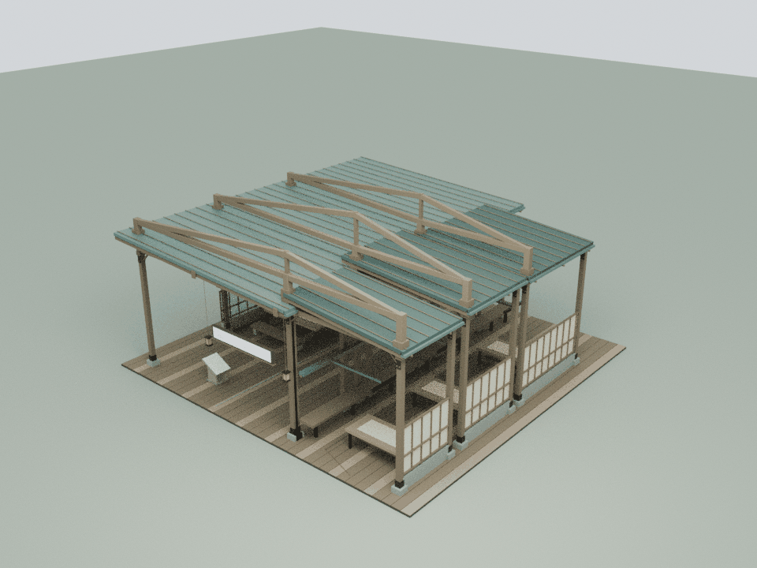
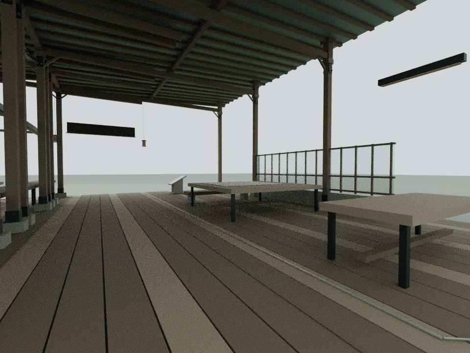
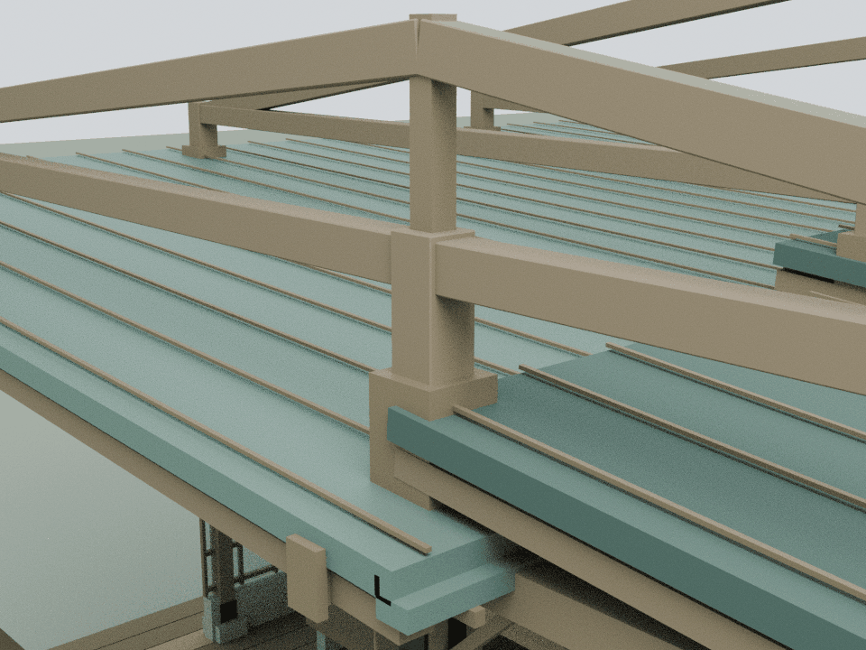

# 置身青媒内：把接力做成可见的构造

本轮仅细化 building19「置身青媒内」，基于已发布的 `62e4317998f330c1adcc4f94a70395a1427e7681`。内容依据仓库已有、经过隐私处理的 `assets/readings/19.json`，保留卷首、现场说明、十五章、末尾图注与来源说明，共19个阅读章节。这里是对公开作品的建筑解读，不是实际办公室或私人群聊的复原。

## 内容与构造

原文从“安排个推送”展开，描述接住需求、整理材料、协调审核、发布、复盘与交接。原建筑已有三间不等大小的接件湾、连续服务台、共享工作庭与空置的接班工位。本轮用跨向共享区域的高位接力桁架把这些依赖关系变成明确的空间轮廓，让支撑共同工作的构件可被看见。

原服务轨上的任务灯继续沿完整行程平移，三个阅读相位不变；后来者的工位与出口继续留空。原文谈到疲惫、补位与把经验留下，本轮不以奖杯、名人雕像或无限增长的阶梯替代这些具体经验。

## 模型与重建

    blender -b -t 2 --python tools/model-handover.py
    node docs/handover-detail-check.cjs
    node docs/handover-regression.cjs
    blender -b -t 4 --python tools/render-handover.py

本轮三道桁架在接件侧的纵向位置分别为 -8.82、-4.37、0.53 m，向共享庭原柱斜跨到 -8.70、-3.50、2.10 m；下弦统一在8.22 m，顶点高9.25、9.85、9.55 m。九根短柱延伸座落原框架，空心铜套筒包住真实穿檐位置。没有新增上层纵向连梁，保留三间接件湾之间原有的天空缝隙。

33个闭合实体合计1,248三角面，雪松与铜色仅2个共享静态批次。上下弦深度分别为0.24与0.20 m，端部每侧形成20 mm错台；0.30 m短柱仍较两弦更宽，避免接合端侧面共面。首轮外景发现的黑三角经此修正后重渲并复核。没有增加灯光、动画或地面障碍。

Blender导出的真实三角网格由 `assets/handover-detail.js` 接入建筑19。可编辑模型与实际运行时装配留在 `qa-results/handover/`；仓库保留生成脚本、网格与三张压缩审阅图，不提交大体积模型源。

## 检查与限制

独立审计从实际网格恢复33个闭合流形实体；2,142条截面射线核验杆件与真实空心套筒，63处正体积接合把全部新构件连接到原建筑。18个穿檐构件有360个实际屋面接触三角。

648个原网格/实例的材质、变换、Canvas文字、碰撞在8个状态逐值保持，19个阅读章节保持。移动任务灯全行程以连续包络核验，新增构件保留25 mm净距。8段2.4 m高身体空间完成87,968次三角与696次碰撞检查；完整文字视域4,992次、工作区13,728次、原屋面缝隙21,992次检查通过。

最终汇总采用53项显式云端CPU检查；72项发布manifest、51项入口缓存版本核对，108份JS/CJS、41份Python AST和36段HTML内联脚本进行语法检查。前18馆预算逐栋不变；累计19馆新增147,704三角面 / 133批次，整栋装配合计411,026三角面 / 962批次。本轮资产99,327字节原始 / 13,555字节gzip-9；19馆detail合计9,030,128字节原始 / 966,679字节gzip-9。原远距LOD节省7,568面 / 60批次保持。

检查只使用显式云端CPU列表，两个Mac Chrome导航脚本不执行；旧wave1哈希前置状态仅与本轮发布基线比对。审阅图将使用真实运行时装配的Blender CPU渲染；Canvas文字纹理未烘焙，文字另用源内容和Canvas回归校验。该检查不替代浏览器交互、GPU帧率测试或实体结构认证。

