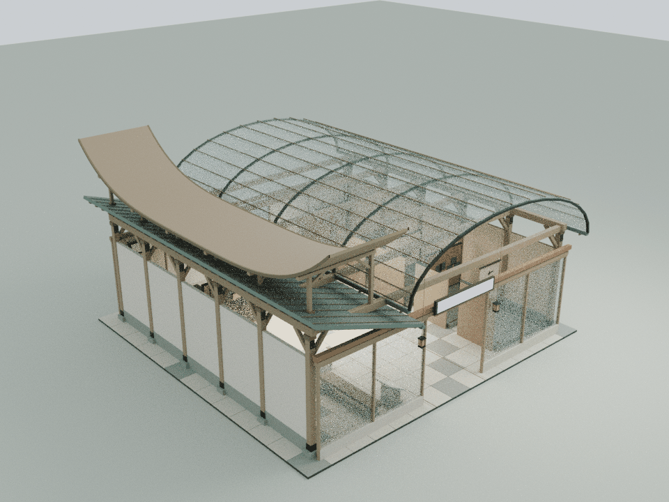
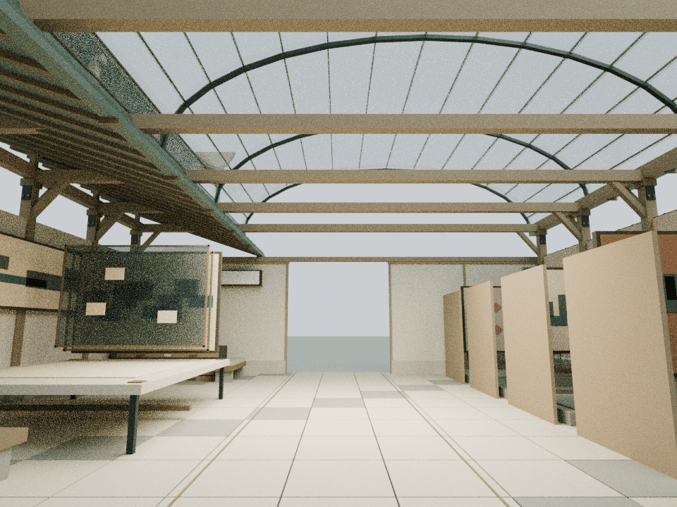
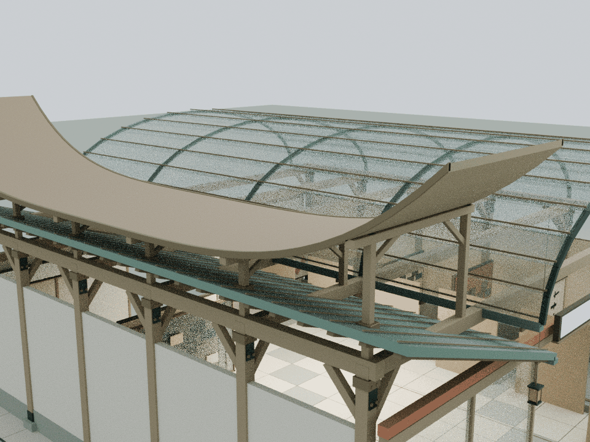

# 画韵新生：舒展长卷与五类展托

本轮仅细化 building1，基线为已发布的 `19102dd19a4c1ab52d485df88f3962c0251ab665`。依据 `assets/readings/1.json` 的五类艺术目录、长卷观看与原图/轮廓/遮罩比较。保留正文、展示对象和固定示例，不生成历史原貌、修复结果或模型宣传指标。

## 内容与构造

- 东侧修复廊上方新增一条两端舒展的长卷形木檐，西侧原透明馆藏拱顶保持完整。新木檐中部高7.8 m，两端10.3 m，纵向连续曲线让“长卷观看”成为远处可辨认的形体
- 木檐宽4.2 m、长20.4 m、竖向厚14 cm，由41个断面构成闭合实体。两条铜色包边收住长卷边缘
- 六组横托梁与十二根短柱落在原框架梁头，保留原铜斜顶；东侧穿过旧屋面的位置设铜套，支撑顶面依实际分段曲线插值，避免浮空缝隙
- 五种原展品分别增加卷轴端片、壁画托唇、纸本边框、青铜展托包角、剪纸斜角细节；均位于原展台范围，原展品不变
- 修复工作台只补四个低矮护角，完整原图及轮廓、遮罩运动范围保持，阅读和比较仍以内嵌文本与原功能完成

## 模型与重建

    blender -b -t 2 --python tools/model-huayun.py
    node docs/huayun-detail-check.cjs
    node docs/huayun-regression.cjs
    node docs/detail-lod-check.cjs
    blender -b -t 4 --python tools/render-huayun.py

56个Blender实体、3,304三角面，实际导出的网格直接用于运行时，木/铜仅2个静态材质批次，没有额外模型加载器。长卷顶面公式为 y=7.8+2.5×(|z|/10.2)^4；41个断面间使用线性面片，底面下降0.14 m。曲率在导出精度下保持非退化，并独立检查实际网格的封闭性。

新增高位挑檐在原建筑finish完成后挂入，保留原width/depth供既有地面阅读台自动布局使用，同时将metadata.bounds和height更新为包含真实木檐的范围；运行时再计算完整剔除包围盒，避免挑檐尺寸挪动原阅读台。

源文件只在 `assets/content-creation-care.js` 的building1增加一个 `CourtyardHuayunDetail.attach(b)`。本地可编辑模型为 `qa-results/huayun/huayun-detail.blend`，实际运行时装配为 `qa-results/huayun/huayun-runtime-assembly.blend`，均不提交仓库。累计资源预算见 `DETAIL_PERFORMANCE_BUDGET.md`。

## 审阅范围

几何、原构件/材质/文字、原图层完整运动、路径和阅读范围由独立云端检查覆盖；本轮明确排除两项硬编码Mac Chrome的导航脚本，不调用或重试浏览器启动。旧wave1的固定LINKS哈希问题与发布基线比较并单独记录，不能据此忽略实际内容变动。

独立检查通过：56个闭合、流形且朝外的实体；3,096条截面射线确认长卷实心截面和开敞空间；52,864次玻璃顶检测通过。只有六根东侧短柱及其六个铜套与旧斜顶相交，192个接触三角均限制在包套范围，所有斜撑避开旧屋面。837个原网格/实例（含原阅读台）在八个状态保持，原碰撞和阅读台位置逐值不变。连续图层运动净空62,776次、八段连续身体净空123,824次、三个完整文字视域9,912次、展品及桌面区域26,432次检测通过。

整院41项CPU检查通过（38项既有检查、2项本馆检查、1项累计LOD），wave1已知前置哈希失败另列，2项Mac脚本在执行前排除。81份JS/CJS、27份Python及34份HTML中的30段内联脚本语法通过，66项发布哈希与45个入口缓存版本核验通过。其余24栋标准馆、3项基础设施和110个保留资产与基线一致。

以下为实际运行时装配导入Blender的CPU审阅图，非网站截图。Canvas文字和木纹贴图未烘焙，浏览器GPU帧率及移动端交互未实测，不构成实体结构认证。

