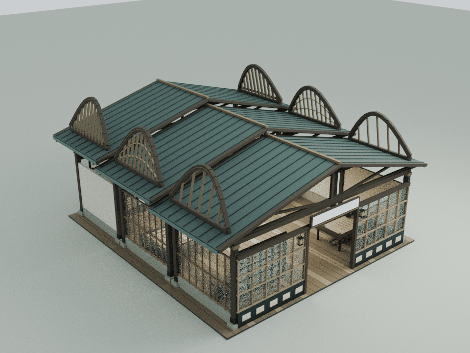
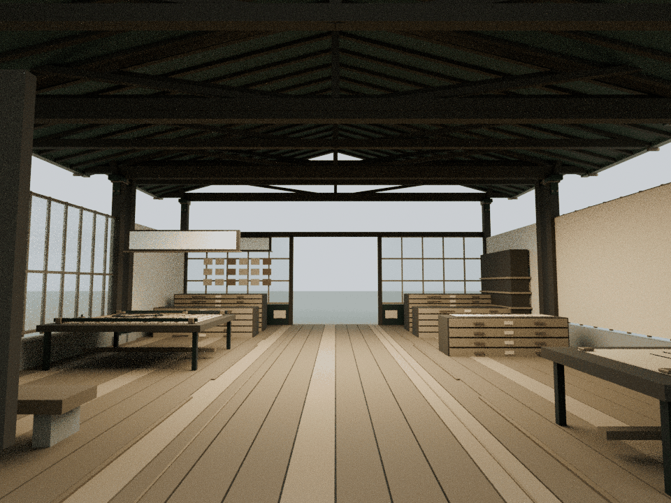
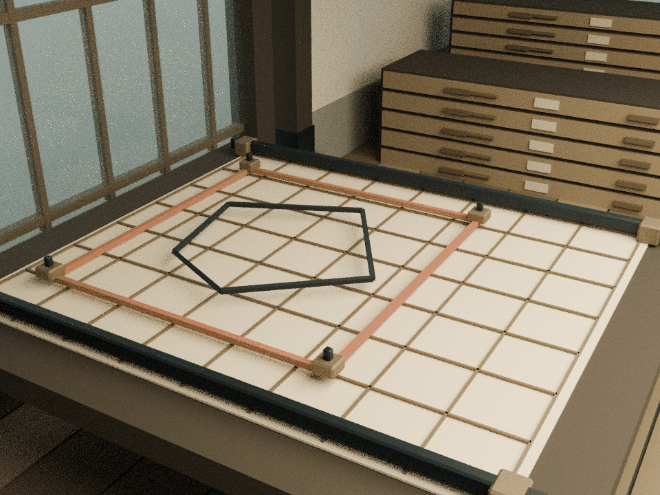

# 墨息：从整幅、边界到档案的六片纸页翼屏

本轮仅细化 building0，基线为已发布的 `308d01f920cf05a68de7f93d29c3c45a4143fa29`。内容依据现有 `assets/readings/0.json` 与原工坊：书法生成、图像标注、数据归档三个连续步骤。建筑呈现其方法，不声称实际调用生成模型、识别、上传或远程保存。

## 构造与内容

- 两侧六片纸页翼屏沿三段原屋面逐级升高。深木色弧形冠梁向内收拢，形成翻开纸页般的高轮廓，仍沿用庭院木、灰绿瓦与少量铜色
- 第一段较疏的连续肋片对应完整图像；第二段横竖格网对应区域和行列结构；第三段密排档案肋片与铜索引片对应可检索归档
- 三段原屋面、全部柱、侧墙、桌柜、字格、地面与内嵌文字均保留。翼屏由原侧柱位置的短斜接柱支承，不占用主通道
- 原矩形、多边形标注机构保持位置变化和旋转规律；新增四角铜定位块与钢定位针跟随原矩形组。固定测量导轨和端靴仍在原受保护工作台范围内
- 生成台增加整幅纸张角夹；档案柜增加实体标签框、纸质索引和铜拉手。并非新增网络功能，也没有将示意标注机构改称真实识别设备

## 重建与运行时

    blender -b -t 2 --python tools/model-ink.py
    node docs/ink-detail-check.cjs
    node docs/ink-regression.cjs
    blender -b -t 4 --python tools/render-ink.py

六个冠梁轮廓各由13个采样点组成，t从0到1：x = 左右符号 × (7.55 − 0.55 sin(πt))；y = 原檐高 + 0.85 + 2.35 sin(πt)；z = 段中心 − 2.5 + 5t。每段12根闭合倒角梁沿连续弧线装配；低位连续梁和细肋共同构成可读的实体框架。

静态398构件、17,512三角面，活动原型8构件、352三角面，共17,864新增三角面、8个材质批次。按材质合批，运行时共享缓存几何；生成的资源约1.22MB，gzip约137KB。`CourtyardInkDetail.attach(b)` 与 `attachCarriage(b,layers)` 分别挂到原建筑和原活动标注组，原源码仅增加这两个挂接点。

可编辑源本地保存在 `qa-results/ink/ink-detail.blend`，实际运行时导入Blender的装配保存在 `ink-runtime-assembly.blend`。这些模型、JSON导出和临时日志不提交；仓库保留生成器、运行时网格、测试、说明和审阅图。

## 验证与审阅边界

- 从运行时材质批次提取72个冠梁实体，每个24顶点、66条闭合边、44三角面；独立重建其曲线和倒角顶点并逐值核验，288条截面射线通过
- 八个往返状态中931个原网格/实例、材质、矩阵保持一致，其中616个低位展陈保持；原碰撞列表与机构公式不变
- 61,960次活动三角与原固定实体检测、1,541,056次活动与新增固定构件检查通过，活动构件距原固定构件的最小间隔约14.5 mm
- 三条连续主通道按0.38 m身体半径检查，603条头顶净空射线通过；六个实际文字平面在八状态下432条阅读视线通过
- 其余24栋标准建筑、3栋基础设施、全部25个原机构、阅读JSON和机械蝶保持；60项发布哈希与39个缓存版本通过，两入口一致
- 31项可运行Node脚本中30项通过，唯一失败为已核对的基线wave1旧LINKS哈希断言，发生在浏览器启动前；两项依赖Mac Chrome的导航脚本明确未运行
- 60个资产JS与验证CJS文件、22段非空内联脚本语法检查通过，`git diff --check` 通过
- Blender生成器完整重跑后资源SHA256完全相同；最终CPU审阅导出包含939个实际网格/实例

浏览器GPU、真实触控和手机帧率未在本轮实测；既有浏览器权限限制未绕过，依赖Mac Chrome的两项导航脚本未运行。`docs/ink-detail-qa.html` 是独立Three.js装配审阅入口。

以下是实际运行时网格导入Blender的CPU审阅图，并非网站截图。Canvas文字与木纹贴图未烘焙；图片用于检查建筑轮廓、通道、实体和活动间隙，不构成实体结构承重认证。

