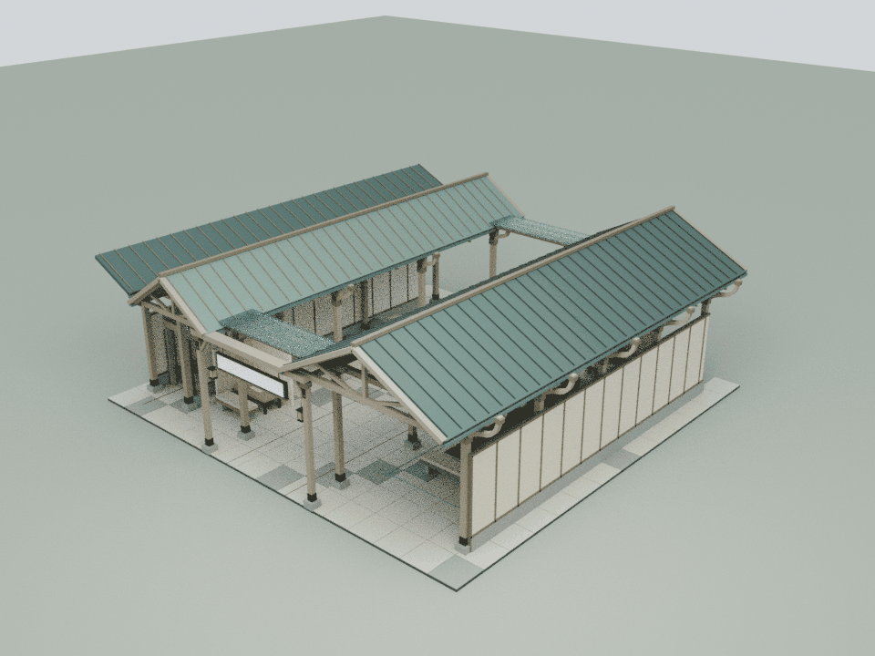
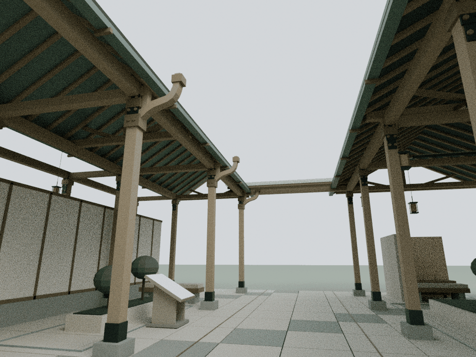
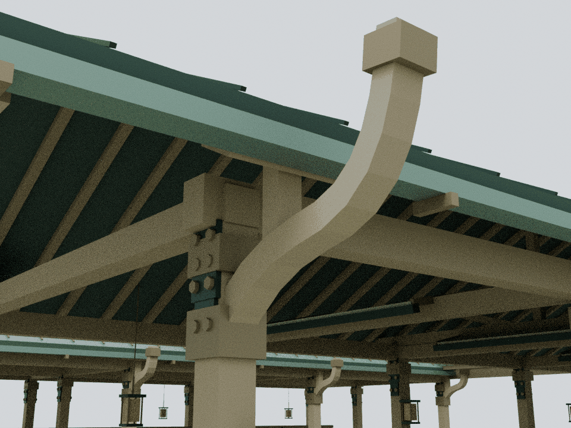

# MindCare：有长短节奏的静观庭廊

本轮仅细化 building24「MindCareAI · 灵愈AI」，基于已发布的 `212c7e4fce41e22c88ce694fff49c53b7c95d2df`。内容依据仓库现有 `docs/content-map.json`、`assets/content-services.js` 与 `assets/readings/24.json` 的公开界面观察，保留六个阅读章节及全部事实边界。

## 内容与构造

原有内容将公开卡片的不同停留时长，映射成长短不等的静观步道；日记与对话方向由有屏风保护的角落表达，用户和医生入口的区分对应独立侧通道。本轮加强左右不对称的庭廊轮廓，让有节奏的弧形构件具有清楚的实际承接关系，中央仍然向天空敞开。

三块原遮光叶继续做小幅、可逆的转动，公共路线、静坐位置和侧向角色门洞不随之变化。这里的节奏是建筑视觉表达，不是医疗指导；不增加量表、记录、诊断、疗效承诺，也不推断登录后工作台内容。月雪相关内容与匿名化完全不在本轮修改范围。

## 模型与重建

    blender -b -t 2 --python tools/model-mindcare.py
    node docs/mindcare-detail-check.cjs
    node docs/mindcare-regression.cjs
    blender -b -t 4 --python tools/render-mindcare.py

本轮为五道长弧肋和四道短弧肋分别配置真实空心根座、环形端箍，以及连接原檐下椽条的短承座与顺坡帽座。每道弧肋形成“原柱—弧肋—承座—帽座—原椽”的可核验接触链，自由翘端仍保留曲线节奏。首轮图审识别出原设计只接柱、不承接檐下的问题，随后补全18个小型承托实体。

45个闭合实体合计1,620三角面，仅橡木与铜色2个共享批次。五道长弧肋位于外侧步道柱列，四道短弧肋靠中央庭院一侧；中央3.6 m天空条带继续敞开。实际包围盒包含外挑构件，原有地面尺寸、通道和阅读布局不变。

实际 Blender 网格由 `assets/mindcare-detail.js` 接入建筑24。模型源与运行时装配存放在本地 `qa-results/mindcare/`；仓库保留生成脚本、网格及三张压缩审阅图，不提交大型模型文件。

## 检查与限制

独立网格审计恢复45个闭合流形实体，4,779条截面射线验证弧肋、空心根座和端箍，63处正体积接合把全部构件接入原柱与原椽。屋面11,340次三角检查证实无穿透；实际导出网格到原屋面的最小净距46.129 mm，126处接合错台最小20 mm。

1,315个原网格/实例及136个碰撞体在8个姿态逐值保持，六个阅读章节与文字位置保持。三块遮光叶的连续转动包络检查包含19,440次三角检测，保留25 mm新增构件净距；2.4 m高连续身体空间检查、完整文字视域6,480次检查、中央天空与既有保护屏风检查均通过，原1 m角色侧门净宽保持。

整院55项显式CPU检查全部通过，执行期间源文件稳定；111份JS/CJS、43份Python AST和37段HTML内联脚本语法通过。157项旧来源逐字节保全核验通过，73项manifest、两入口各52项缓存版本一致。前19馆预算逐栋保持。

本轮资产154,815字节原始 / 16,398字节gzip-9；累计20馆新增149,324三角面 / 135批次，整栋装配合计433,012三角面 / 1,008批次。20馆detail合计9,184,943字节原始 / 983,077字节gzip-9，原远距LOD节省7,568面 / 60批次保持。

检查不执行两个Mac Chrome导航脚本；旧wave1哈希状态只与精确发布基线作源文件对照。下图是实际运行时装配的 Blender CPU 审阅图；Canvas文字纹理未烘焙，文字内容另行检查。审阅不代替浏览器交互、GPU帧率测试、实体结构认证，也不验证医疗产品宣传。

