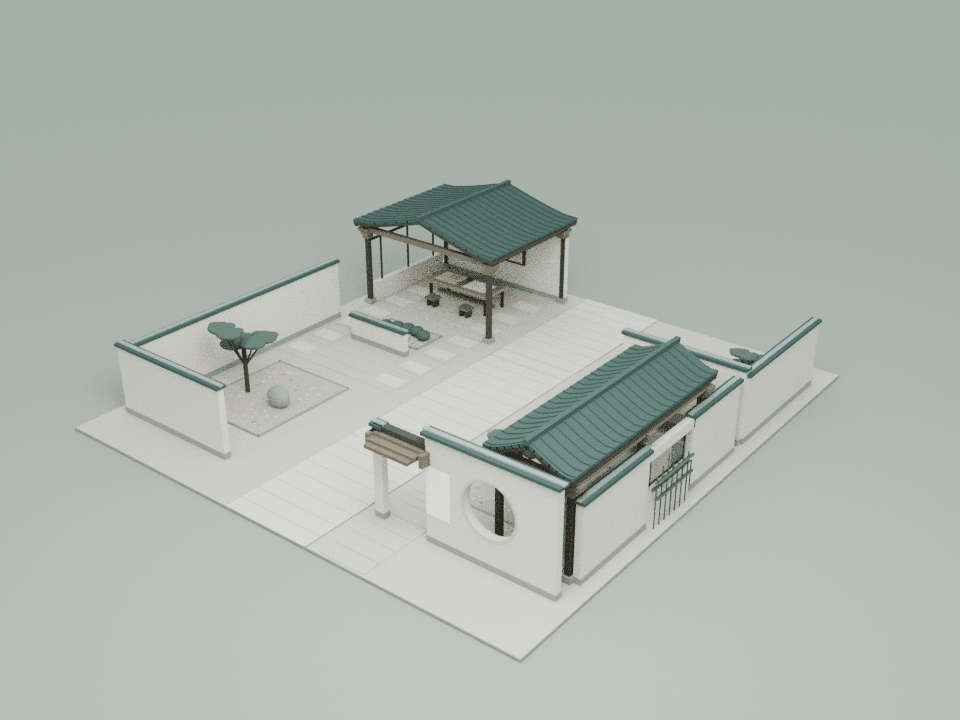
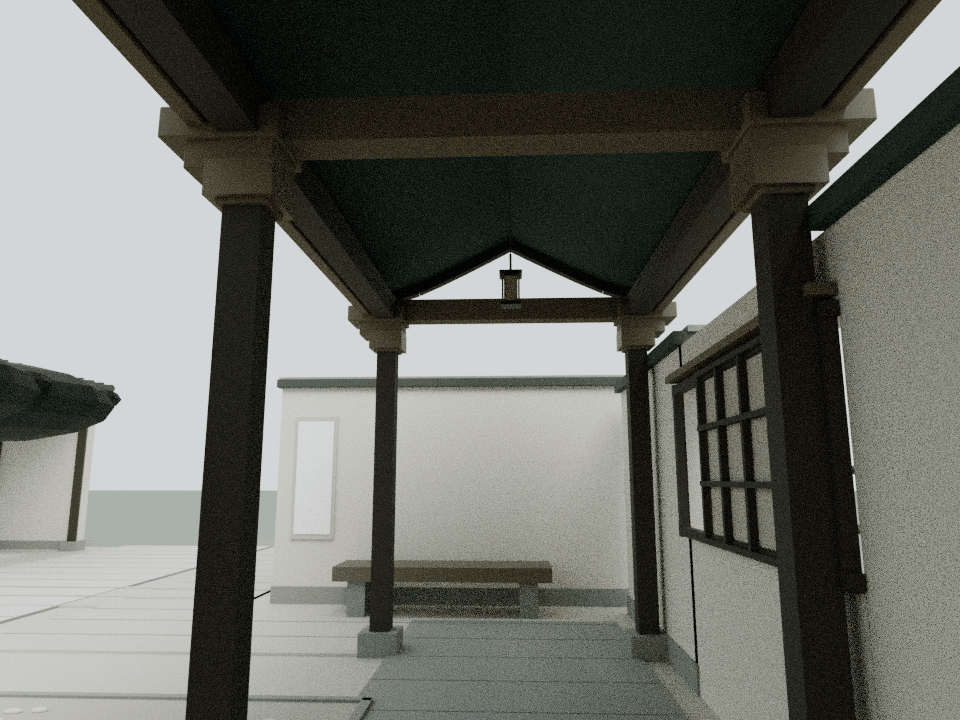
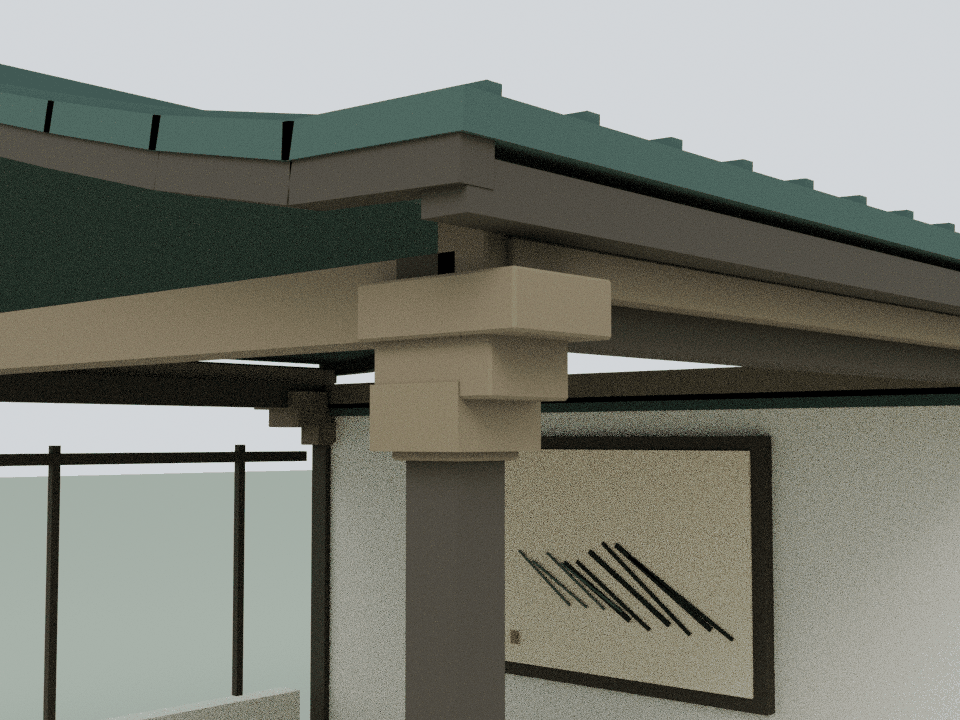

# 月雪：转折廊与共同书房的真实接合

本轮仅细化 building20「月雪」，基于已发布的 `7be2e7b9fcba939ebc9c70a5e363a6bd84ee59a7`。依据现有匿名化展陈与建筑源代码进行几何设计；`assets/readings/20.json` 的12节匿名正文、来源处理及既有隐私规则保持不变。

## 内容与构造

生产入口在 `content-literary.js` 后加载 `moon-snow-garden.js`，实际建筑是偏置月窗、转折长廊、留白静庭与共同书房。原先的七框方案已被替代，不作为本轮设计或验收依据。精修只增强最终实际花园的廊与书房构造，保留月窗视野、空白墙、两条等宽书房路径与全部原有陈设。

原漏窗格扇继续沿原轨迹平移，四处内嵌文字及12个阅读锚点保持，不新增灯光、粒子或叙事文字。本轮不重构人物身份、不补充原始来源回链，也不添加未经现有展陈支持的关系结论。

## 模型与重建

    blender -b -t 2 --python tools/model-moonsnow.py
    node docs/moonsnow-detail-check.cjs
    node docs/moonsnow-regression.cjs
    blender -b -t 4 --python tools/render-moonsnow.py

新增53个闭合实体、2,212三角面，使用雪松与铜色2个共享批次。旁门有三层短叠口与座落原构造的返回件；转折长廊与共同书房的双层檐收边，由原柱上的逐级托块与真实空心套座承接。书房后端托块按既有墙压顶精确错开，不穿原压顶或屋面。

实际 Blender 导出网格由 `assets/moonsnow-detail.js` 接入建筑20；原布局完成后再附加并更新包围盒，保持地面尺寸、文字布局和通行。可编辑模型与实际运行时装配留在本地 `qa-results/moonsnow/`，仓库仅保留生成脚本、运行时网格与三张压缩审阅图。

## 检查与限制

独立网格审计恢复53个闭合流形实体，1,430条截面射线验证真实构件与空心套座；81处正体积接合使全部新增构件接入原结构。490个实际瓦面、瓷压顶与屋面构件完成1,083,880次三角检查。26段2.4 m高身体空间完成2,056,704次三角与1,664次碰撞检查。原漏窗9个活动子件的连续扫掠检查保持25 mm新增构件净距。

四处内嵌文字、11个完整视锥与12个阅读锚点、月窗透景、空白墙、书案、画框及全部既有路线单独核验；66处端面和侧面错台实测通过。1,293个原网格/实例与65个碰撞体在8个姿态比对；除下面明确的91项铺地Y位移外，其余原几何、变换、材质、文字与动作保持。整院57项显式CPU检查全部通过，392项源哈希在执行期间稳定；114份JS/CJS、45份Python AST和38段HTML内联脚本语法通过，168项独立来源保全核验通过。74项发布manifest、两入口各53项缓存版本核对一致。生产加载顺序核验确认全部21馆精修组最终各挂载一次，既有20馆预算逐栋不变。

本轮资产165,872字节原始 / 19,269字节gzip-9；累计21馆新增151,536三角面 / 137批次，整栋装配合计512,116三角面 / 1,058批次。21馆detail合计9,350,815字节原始 / 1,002,346字节gzip-9。月雪最终实际花园原基线为76,892面 / 48批次，本轮后79,104面 / 50批次；没有将已被覆盖的旧七框构造计入或恢复。原远距LOD节省7,568面 / 60批次保持。

铺地例外使用精确的91实例变换、材质与索引白名单；273项负控制检验确保不能顺带放过其他原件修改。两个Mac Chrome导航脚本未执行或解析；旧wave1哈希状态仅与发布基线作源对照。首轮图审及同机同相机基线对照确认，原13片铺地存在14处正面积共面交叉。按交叉关系分为两层，仅6片纵向铺地及对应85条细缝上移1 mm，另外7片不动；平面位置、几何尺寸、材质与碰撞保持。修后真实运行时装配重新渲染，黑块消失，未在渲染转换中另作遮掩。91个原实例的明确位移单独列出，不能称为所有原几何完全未变。匿名正文及相关原资产进行逐字节核对，不以截图代替隐私保全检查。图为实际运行时装配的 Blender CPU 审阅，Canvas文字纹理未烘焙；不代替浏览器交互、GPU帧率或实体结构认证。

