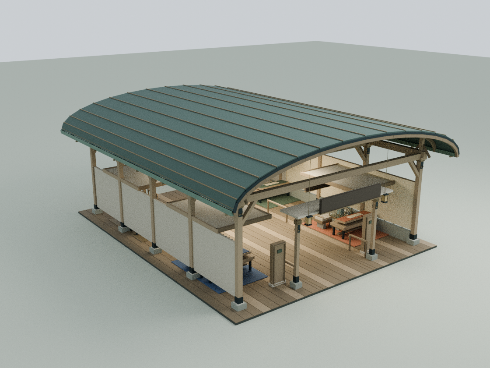
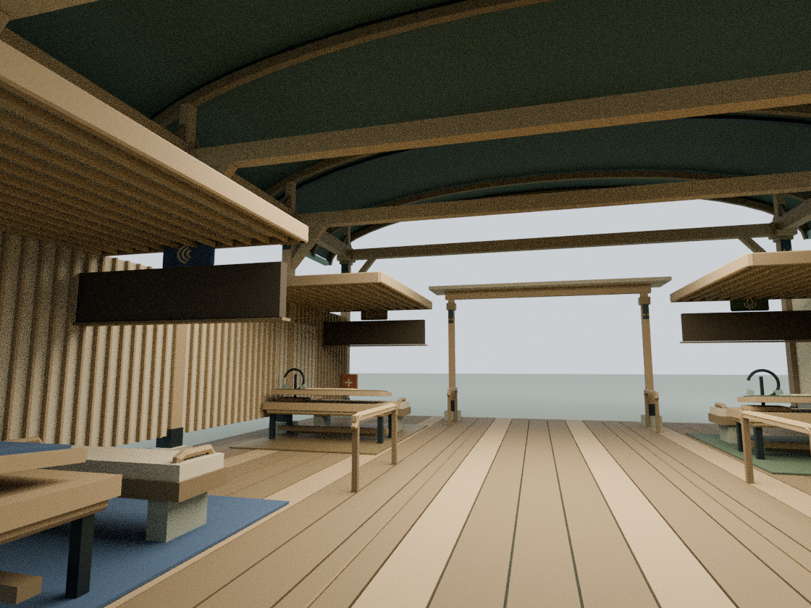
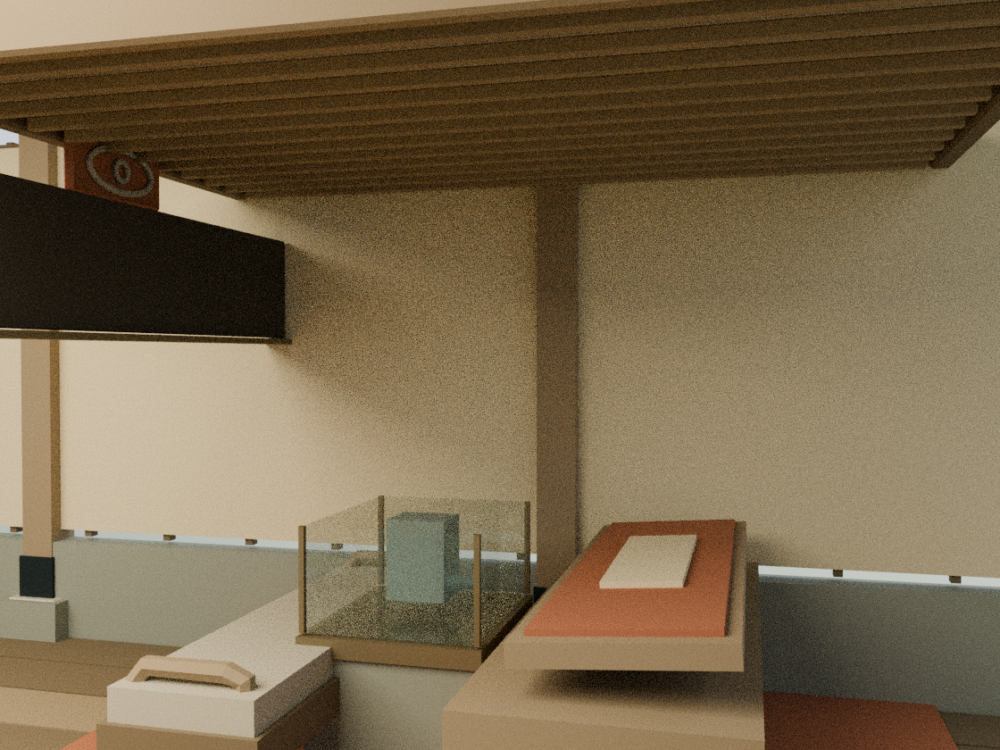

# 暖聆 App 馆：四项可达操作湾

建筑编号为 5；主入口仍指向 https://nuanling.maniforld.com/app/ ，并保留与编号4家庭端的关系。生产基线包含 main `9f2743e5e095da869a5594e8c266fe3de7709c76` 的机械蝶自动飞行。

## 内容决定建筑

依据现有 `assets/readings/5.json` 中2026-10-09核对的公开内容，长者端把连接状态放在前面，再分为看、听、说、聊。本轮尝试重新打开公开站点未成功，因此未增加任何新的产品功能或健康效果声明。

这栋保留原纵向拱顶与四个浅湾，不复制家庭馆的四坡屋顶/格窗：

- 木拱肋、柱头承托与弧形端部收边强调一条清楚的直通路径
- 每湾的吸声顶棚增加木格栅、边框；座椅增加圆角扶手与软包缝边
- 低位桌面有圆角围边和脚踏，仍位于原有受保护操作台范围内，不妨碍台面倾转
- 原看、听、说、聊文字保持原位，另用眼睛、声波、麦克风、往返对话的实体图形辅助辨认，不能仅靠颜色辨认
- 中轴扶手仍分段，补圆握把与回弯端部；门口状态柱增加框边，不编造设备状态或用户数据
- 扩大的柱脚石座有对应实体碰撞盒，不让模型与通行边界脱节

这是概念建筑细化，不代表实际无障碍规范认证或结构工程计算。

## Blender 与运行时是同一套几何

`tools/model-nuanling-app.py` 在 Blender 中创建336个具名可编辑构件，转换曲线、微倒角和三角网格，输出 `assets/nuanling-app-detail.js`。运行时直接读取这些求值后的顶点，合并为8个材质批次，共15,940三角面，gzip约106KB。不引入新加载器、外部CDN或付费API。

    blender -b -t 2 --python tools/model-nuanling-app.py
    node docs/nuanling-app-detail-check.cjs
    node docs/nuanling-app-regression.cjs
    blender -b -t 4 --python tools/render-nuanling-app.py

源模型保存在本地 `qa-results/nuanling-app/nuanling-app-detail.blend`，完整运行时装配模型是 `nuanling-app-runtime-assembly.blend`，均不加入Git。仓库保留重建脚本。

## 验收边界

18项脚本检查中17项通过，唯一失败为下述已知旧LINKS哈希断言。

- 全庭28栋静态几何检查、中心通道碰撞和新增几何净高检查
- 新增顶点有限、三角面无退化、原机构多状态反复切换；四个图形标记逐一射线验证未被底板或顶棚遮挡
- 其余24栋标准建筑相对蝶提交3ffb1a6的实际几何逐值相同；暖聆家庭馆保留
- 蝶自动飞行、固定访客入口、铭文视线、阅读、核心动作、月雪、手机布局源码和天气回归
- 两入口文件一致，新模型与改动脚本的缓存哈希同步，发布清单53项哈希逐项核对
- 老 `wave1-check.cjs` 仍在浏览器启动前受旧LINKS哈希断言阻止；该失败已在先前生产基线复现，本轮不将它算作通过

未再次尝试绕过已确认的云端Chromium socket权限限制。本轮没有浏览器GPU或真实手机实测。Blender审阅图来自实际Three.js网格装配，使用补光；文字Canvas贴图与木纹没有烘焙，不是浏览器截图。

## 审阅图

