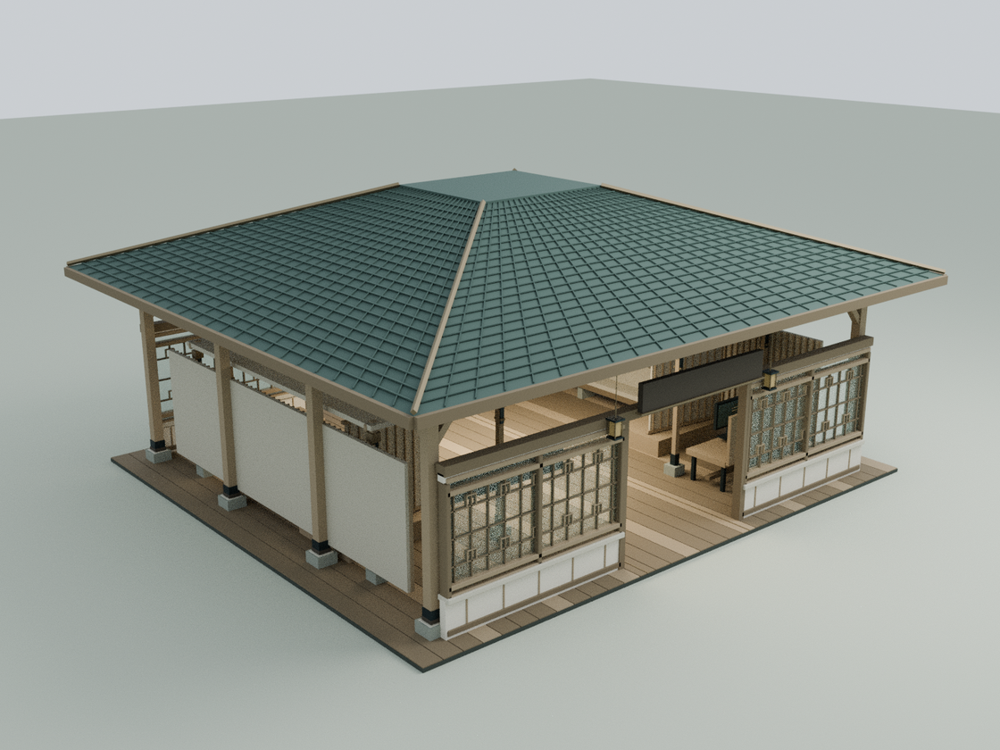
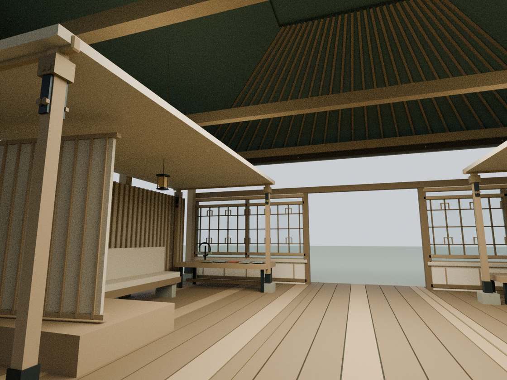
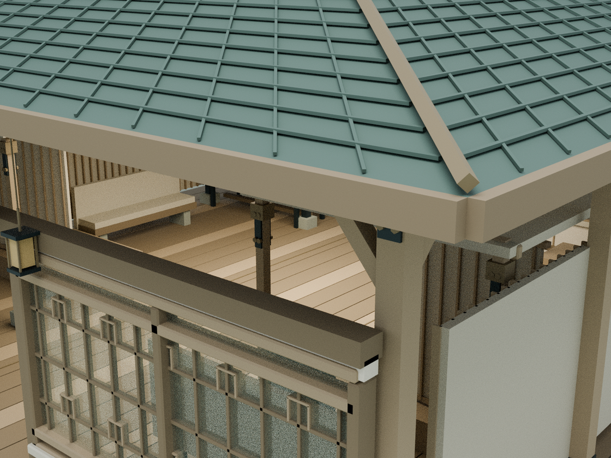

# 暖聆馆：第一栋细化模型

基线：`ed2cab469fc2eb8008b48981b4723f8b19461446`。本轮只修改 building 4。尚未推送或发布。

## 模型预览

以下为 Blender CPU 构件审阅图，不是浏览器截图；文字贴图未烘焙。

## 建筑改动

- 柱脚石座、木柱套脚、柱头承托块与双向承托臂，接到原八根外柱
- 与原屋面坡度一致的瓦垄和叠瓦横缝，保留闭合屋壳
- 深檐封檐板、退进阴影线、按间距排列的外露椽尾
- 前后四组窗：低矮粉墙、石窗台、木框、回纹细格和透光玻璃
- 保留中轴 4.2m 门洞、原地坪、听室、家具、机构、牌匾和阅读系统
- 听室顶棚收边、软包缝线、额枋与木销
- 16cm 四片闭合四坡屋面壳体保留（本模型为艺术建筑，非施工设计）

`tools/model-nuanling.py` 在 Blender 内建立 596 个有名称的可编辑构件，应用微倒角，再将经过 Blender 求值的三角网格输出为 `assets/nuanling-detail.js`。运行时直接使用这些相同的顶点，不是未接入的独立展示模型。合并为 5 个材质批次，共 20,464 三角面；源 JS 约 1.2MB，gzip 约 122KB。不新增外部依赖、请求或付费服务。

## 重建与检查

    blender -b -t 2 --python tools/model-nuanling.py
    node docs/nuanling-detail-check.cjs
    node docs/nuanling-regression.cjs
    blender -b -t 4 --python tools/render-nuanling.py

Blender 可编辑源模型输出到 `qa-results/nuanling/nuanling-joinery.blend`。完整运行时装配模型为 `nuanling-runtime-assembly.blend`。三张 CPU 渲染图为 `blender-exterior.png`、`blender-interior.png`、`blender-joinery.png`。完整装配从实际 Three.js 几何（含实例矩阵）导出；文字 Canvas 贴图和木纹贴图没有烘焙，且使用补光展示构件，因此渲染图不代表浏览器文字效果。

独立浏览器检查页：`docs/nuanling-detail-qa.html`，`?interior` 为室内镜头。当前云端 Chromium 启动被 socket 权限阻止，未通过更改权限规避；浏览器图形、真实交互、手机表现和帧率尚未验证。

## 已通过

- 全庭 28 栋结构/几何静态检查
- 暖聆新增几何坐标、20,464 三角面、5 个材质批次、实际网格净高射线检查
- 三条通行线 + 0.38m 角色半径的碰撞检查
- 原 16cm 屋面闭合、绕序、上下射线检查
- 其余 24 个标准建筑几何逐值与基线相同，全部原机构名称保留
- 现有阅读窗、阅读面板、内容路线、核心动作与渐进披露、月雪花园回归检查

## 额外回归说明

本轮运行所有 `*check.cjs`：12 项通过；`wave1-check.cjs` 在进入浏览器前被旧 LINKS 哈希断言阻止。已在原基线 ed2cab4 上重跑，得到相同失败；本轮未改动 LINKS。没有把这一旧断言失败视为通过。铭文视线检查允许新增模型脚本标签，但保持原 UI 头部与输入处理器哈希不变，42 项检查通过。

## 接下来

先在允许的浏览器环境核对暖聆真实材质、文字视线和入口反复通行，再进入相邻暖聆 App 馆。第二栋可沿用木构语汇，但按大字操作台和长者端动线分别建模。不要批量复制同一栋模型覆盖所有建筑。
