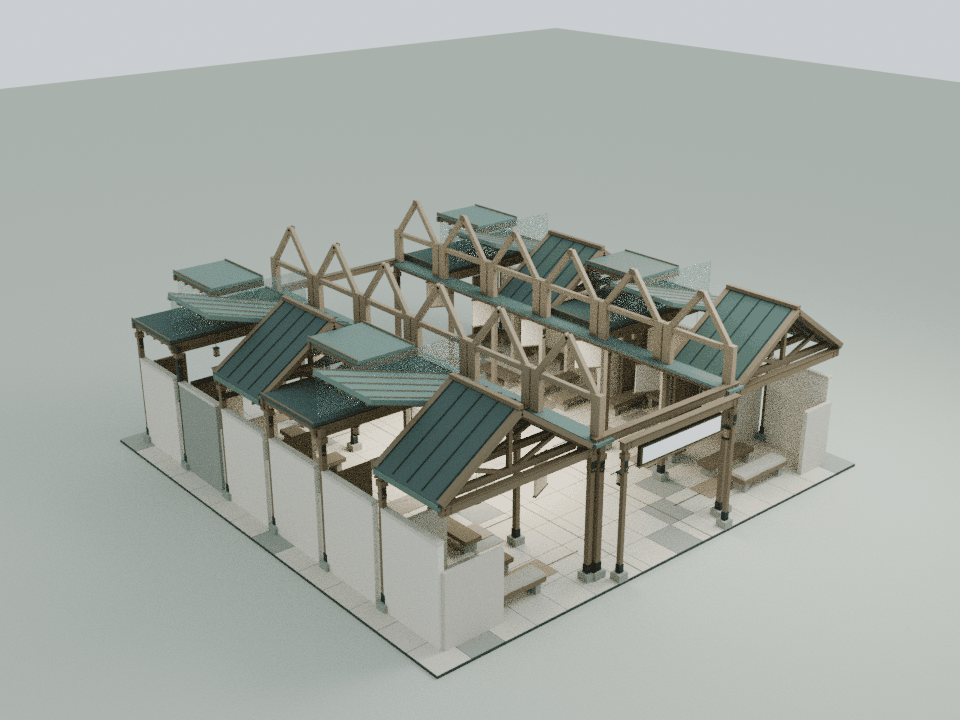
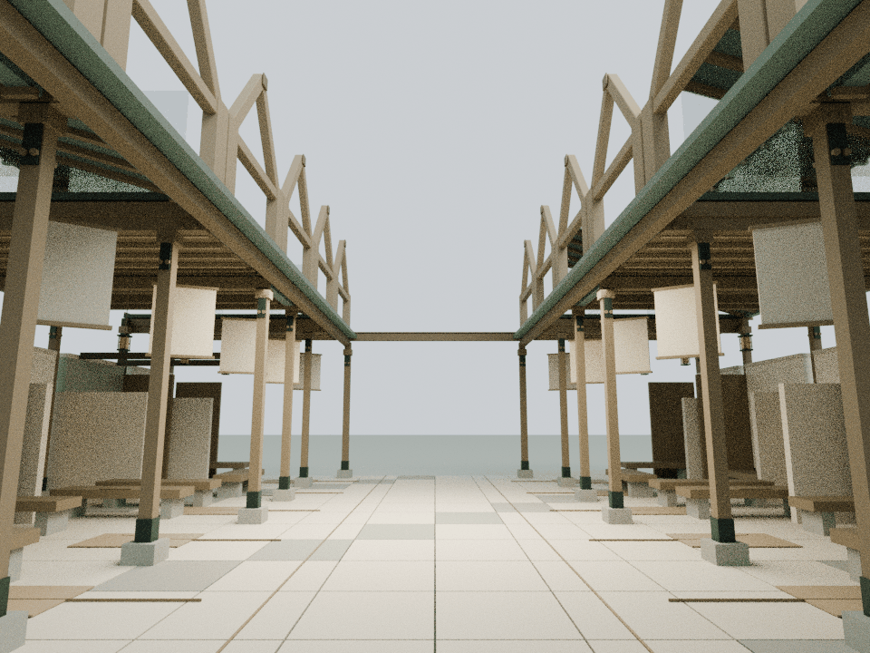
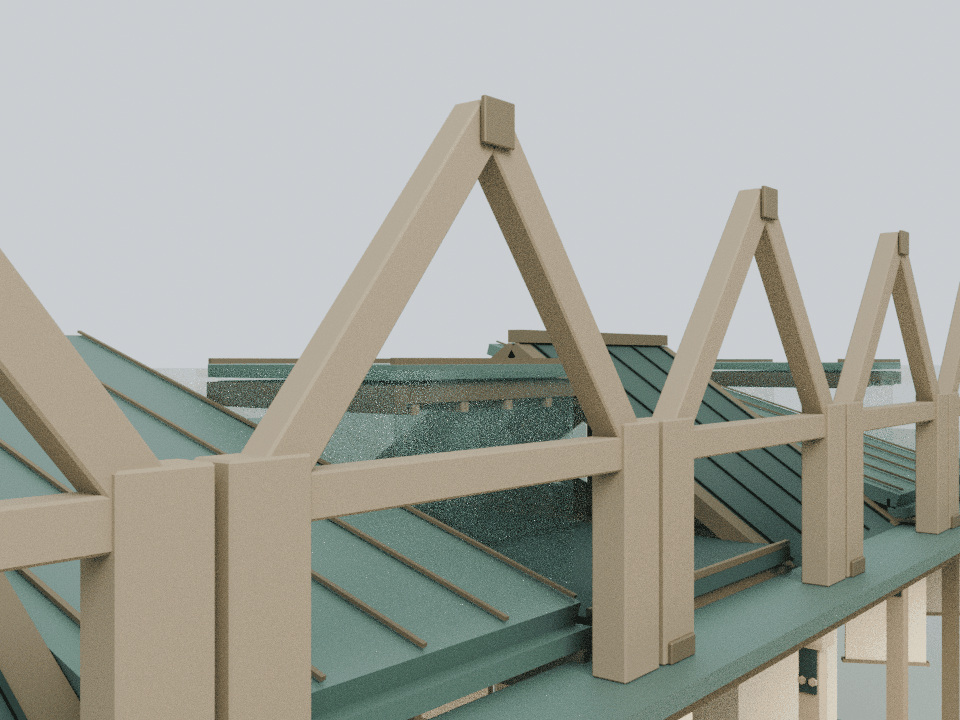

# 人物篇十二传：十二个等高折页檐冠

本轮仅细化 building14，基线为已发布的 `b958c3a6835974daf9dccc24d3110a28f7ae46cc`。依据 `assets/readings/14.json` 与原建筑的十二个等位小间：十二种关系的距离各不相同，却都构成同一人的生活。建筑没有增加人物身份标签、关系排名或新的性格判断，既有正文完全保持。

## 内容与构造

- 两条原连续檐廊上新增十二个等高开放折页檐冠。每个冠顶均为8.2 m，三角木框、下拉梁与两根加厚榫座式短立柱把各间接入共同檐廊，保持并列关系
- 原十二间的三种屋面、不同门槛深度、各异坐席、旧木梁和原第十一间的材料痕迹完整保留；新增冠架不是替换原屋面
- 三种座位方向分别增加贴近座面前沿的薄铜嵌条，全部位于原坐席平面范围之内；外墙增加小型石质压顶
- 十二片原活动遮屏保持独立角度与原运动公式，没有增加十二套活动网格。新构件全部为静态合批，避免每间再增绘制批次
- 冠架最低支承位于5.11 m的原檐面上方，墙压顶从原3.6 m墙顶延伸，不侵入人行空间

## 模型与重建

    blender -b -t 2 --python tools/model-portraits.py
    node docs/portraits-detail-check.cjs
    node docs/portraits-regression.cjs
    node docs/detail-lod-check.cjs
    blender -b -t 4 --python tools/render-portraits.py

108个Blender构件、4,752三角面，按木、铜、石合为3个材质批次。冠顶三角形坐标独立重复：x=左右符号×3.27，z=-8.15+3.26×间序，端点为y6.45/z±1.4，顶点y8.2/z中心。每根梁为闭合倒角实体，运行时直接采用Blender导出的同一三角网格并缓存共享。

源码仅增加 `CourtyardPortraitsDetail.attach(b)` 一个挂接点。原活动细节的远距LOD保持，本轮新增的共同建筑轮廓保持远处可见。本地可编辑源为 `qa-results/portraits/portraits-detail.blend`，实际运行时CPU装配为 `portraits-runtime-assembly.blend`；模型、导出与临时记录不提交仓库。

## 验证与边界

- 108个实际倒角实体的闭合拓扑、正体积与独立坐标通过；十二个冠架等高轮廓、压顶及座面嵌条范围分别核验
- 八个往返状态下1,463个原网格/实例逐值保持，其中1,059个低位构件保持；原材质、碰撞、文字和十二个独立遮屏节点不变
- 十二片遮屏与新增固定三角面共1,368,576次净空检测通过
- 中央路线与十二个实际门槛接近段按0.38 m身体半径连续检查，763条头顶净空射线、600条文字视线通过
- 其他馆、机械蝶与既有LOD保持；发布清单64项哈希与43个入口缓存版本逐项核验，71个资产JS与验证CJS文件、25段非空内联脚本语法通过，38项可运行整院检查中37项通过，唯一失败为已核对的基线wave1旧LINKS哈希断言，发生在浏览器启动前；两项Mac Chrome导航检查未运行

原地面引导线末端有部分指向坐席，不能把这些末端直接视为可站立点；检查使用原座位前实际可达的停留位置，并保持引导线原样。

累计预算与既有远距减负见 `DETAIL_PERFORMANCE_BUDGET.md`。浏览器GPU、触控和移动端帧率未实测；两项依赖Mac Chrome的导航检查未运行，既有权限限制未绕过。

以下为实际运行时装配导入Blender的CPU审阅图，并非网站截图。Canvas文字与木纹贴图未烘焙；用于检查轮廓、空间、构件和活动间隙，不构成实体结构认证。

