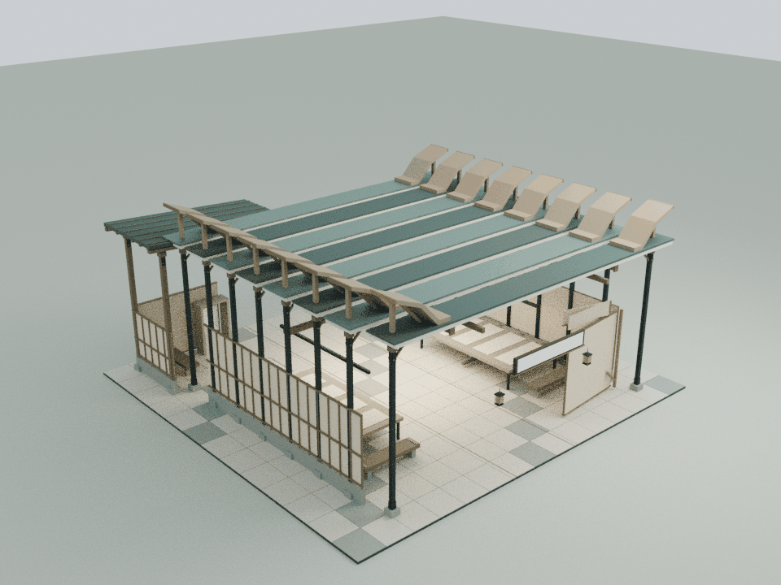
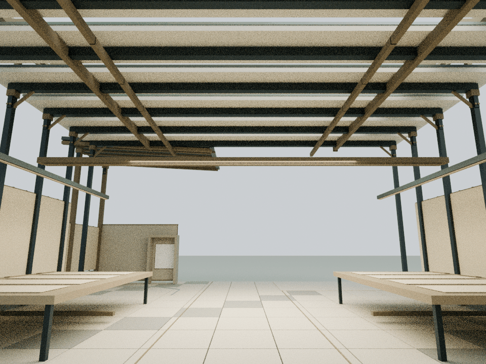
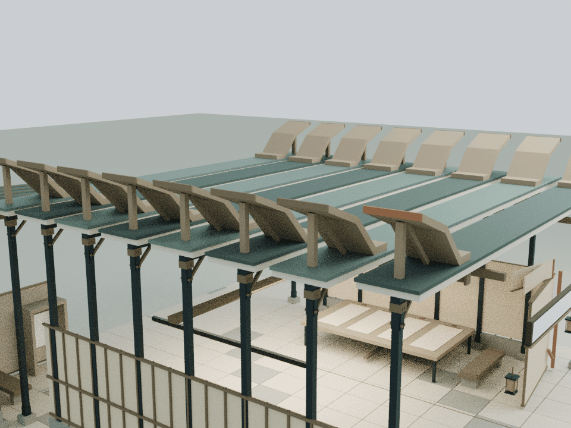

# 清样之前：保留错位的八组折边

本轮仅细化 building21，基线为已发布的 `ab4aedbbe3380eb9e4bdc82bfaec7a7e1aa89e05`。依据 `assets/readings/21.json` 的八次校改、两侧协作与个人复习边界。原文及其早期判断、疲惫和退出边界保持，不补写人物评价或虚构对话。

## 内容与构造

- 八组原屋面外缘各增加一对上翻木质折边。所有折边等高，保留并列的八次校样，不把阶段排成越来越高的成绩序列
- 第一组及其支撑、包边共同保留x=-0.38 m的原错位；这组细窄包边采用陶土红，与原校改缝呼应。后续包边为克制铜色
- 折边为有厚度的连续实体，内侧脚落在原屋面上，外端升至9.08 m；短柱和斜撑位于原框架柱位上方的屋面，不占室内通道
- 两张工作台分别保留四张原校样和交替任务条，只补原桌面范围内的夹具；两张原长凳补座面端片
- 原批注铰接动作继续揭示较早清样，红色校改缝不被覆盖。后部个人页边与退出空间不增加展物，真实后墙铭文保持

## 模型与重建

    blender -b -t 2 --python tools/model-proof.py
    node docs/proof-detail-check.cjs
    node docs/proof-regression.cjs
    node docs/detail-lod-check.cjs
    blender -b -t 4 --python tools/render-proof.py

76个Blender实体、3,088三角面；木、铜、陶土红3个静态材质批次。折边由八点闭合截面沿原屋面板纵深挤出1.28 m，实际三角网格直接接入运行时，原屋面不替换，无额外模型加载器。

`assets/content-literary.js` 只在building21增加一个 `CourtyardProofDetail.attach(b)`。新增组在原finish完成后挂入，保留原width/depth供地面与文字布局使用，实际包围盒与高度包含折边。可编辑源为 `qa-results/proof/proof-detail.blend`，实际运行时装配为 `qa-results/proof/proof-runtime-assembly.blend`，大模型不提交仓库。累计预算见 `DETAIL_PERFORMANCE_BUDGET.md`。

## 检查与限制

独立云端检查覆盖原网格、材质、文字、批注完整运动、碰撞、真实铭文位置与阅读视域；其余馆与机械蝶保持。采用显式检查列表，执行前排除两项Mac Chrome导航脚本。旧wave1前置哈希问题与真实发布基线单独核对。

几何检查确认76个闭合、流形且朝外的实体；16,128条截面射线确认16个折边实体。折边脚、短柱和斜撑共48个实体与原屋面形成976个三角接触，第一组-0.38 m错位保持。673个原网格/实例、材质、Canvas文字与碰撞在八个状态逐值保持；原批注连续运动与新增构件间25 mm净空完成9,264次检测。14段身体净空181,216次、两个完整文字视域6,176次、原纸面与场地区域33,968次检测通过，后部左侧余白保持空置。

整院45项CPU检查通过；旧wave1前置失败单列，两项Mac脚本执行与语法扫描均排除。96份JS/CJS、33份Python、36份HTML中的32段内联脚本语法通过；68项发布哈希、47项缓存版本核验通过。其余24栋标准馆、3项基础设施与112个保留资产不变，另有28处包边/家具真实接合独立通过。

以下是实际运行时装配导入Blender的CPU审阅图，非网站截图。Canvas文字与纹理未烘焙，GPU帧率和移动端交互未实测；不构成实体结构认证。

