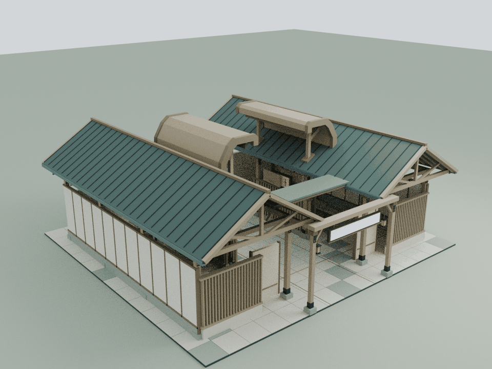
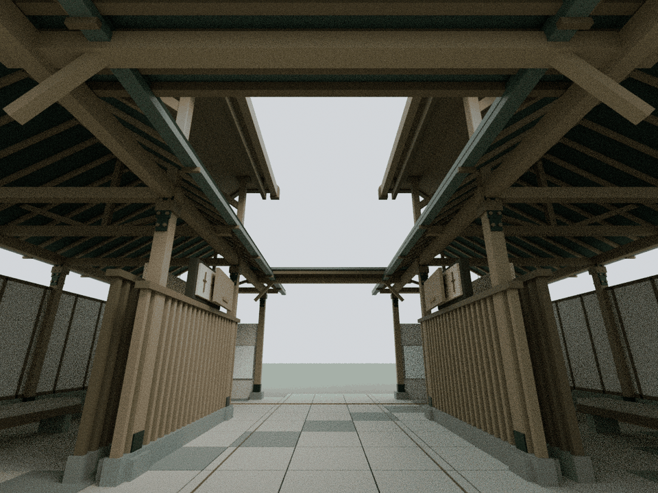
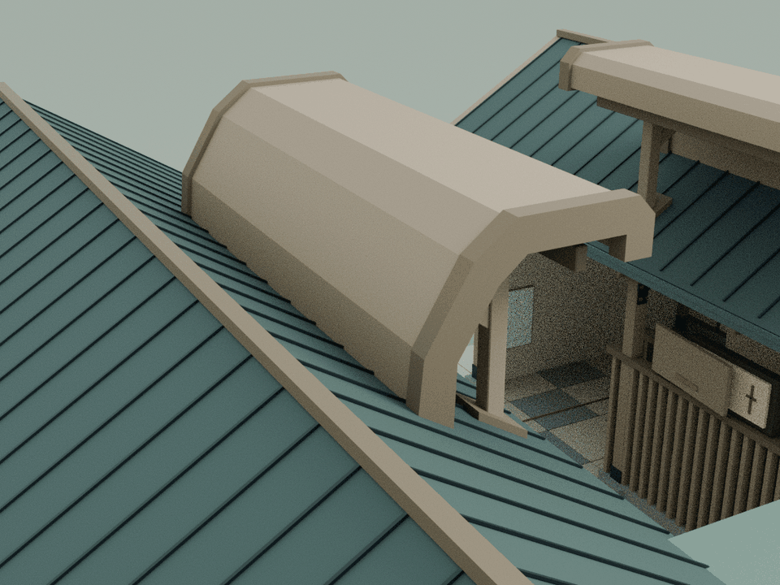

# Reme：分开的两端与限时事件窗

本轮只细化 building12，基于已发布的 `c07a41583f23e0c37f02f04f50b27132b91a7a80`。依据仓库已复核的 `assets/readings/12.json`：家中端把本机视频转换为姿态与事件，家属端关注经过选择的事件；匿名骨架、限时原画和服务依赖都有明确边界。原公开演示并无账号验证，限时画面可能向全部在线 Viewer 显示，因此本馆不把它表述为已建立逐户隔离的私人照护服务。

## 内容与构造

两侧原低宅的内檐各增加一片紧凑、折回的木质护檐，形成两端分开的轮廓。朝向院内的下翻边、端部包边与支承强调屏蔽和有限开口，中央保持露天。护檐不跨接成连续视频墙，也不把两侧变成彼此可直视的透明展柜。

原限时事件窗仍只在中间状态短暂位移，最后回到关闭；双层格栅、错位实心背板和匿名杆件始终保留。原文、原家具、平层路线与阅读位置不改，不增加真实家庭影像、采集权限、健康判断或告警。新增构件全部处于高位，不在入口和院内摆设额外装饰。

## 模型与重建

    blender -b -t 2 --python tools/model-reme.py
    node docs/reme-detail-check.cjs
    node docs/reme-regression.cjs
    node docs/detail-lod-check.cjs
    blender -b -t 4 --python tools/render-reme.py

本轮模型为28个闭合实体、1,128个三角面，橡木和深雪松2个静态批次。两片连续护檐各沿纵深延伸6.6 m，端部包边使最高点达到8.24 m；四根延伸柱从原内檐柱头 y=4.80 m 接起，斜向屋面套座包住穿檐位置。两个护檐之间没有新增连接构件。

实际 Blender 三角网格由 `assets/reme-detail.js` 接入运行时，无额外模型加载器。`assets/content-services.js` 只在 building12 增加一个 `CourtyardRemeDetail.attach(b)`。新增组在原 finish 完成后挂入，保留原 width/depth 与阅读布局，实际包围盒与高度纳入新增构件。

可编辑源留在 `qa-results/reme/reme-detail.blend`；实际运行时装配留在 `qa-results/reme/reme-runtime-assembly.blend`。模型与运行时导出不提交仓库，生成脚本及代表审阅图提交。脚本二次重建后的运行时资产 SHA256 完全一致：`1baeda13f806059668b515b94ef67a42f55c94fd139c65fd41879511309bb959`。累计预算见 `DETAIL_PERFORMANCE_BUDGET.md`。

## 检查范围与限制

独立云端检查使用实际网格而非建模标签，核对闭合实体、真实接合、原构件与运动、通行净空、原阅读内容和视域。发布级回归核对其余建筑、机械蝶、发布哈希和缓存版本。只执行显式列出的云端 CPU 脚本，两个 Mac Chrome 导航脚本不执行；旧 wave1 哈希前置状态与本轮基线单独对照。

实测28个闭合、朝外、流形实体，8,190条截面射线核对完整折回截面；42处连接均具有正体积接合，每个新增实体都有接合路径通向原建筑。171次屋面三角接触限定在护檐落脚与四处带套座的支承位置。1,170个原网格/实例及材质、文字、碰撞、运动在8个状态保持，6个阅读章节和3个阅读相位的真实 Canvas 绘制保持。

原事件窗完整连续运动与新构件之间保留至少25 mm净空，完成4,512次三角检查。9段连续2.4 m身体净空完成175,986次三角和2,088次碰撞体检查；3个完整文字视域完成3,384次检测，1,260条射线核对原实心隐私背板。

整院47项CPU检查全部通过；69项发布哈希、48项入口缓存版本一致。99份JS/CJS、35份Python和37份HTML中的33段内联脚本语法通过。其余24栋标准馆、3项基础设施、25项原机制及113个保留资产通过隔离回归。累计16馆新增142,600三角面、127批次；Reme本轮资产仅79,585字节原始 / 10,363字节gzip-9。

以下为实际运行时装配导入 Blender 后的 CPU 审阅图。Canvas 文字与纹理未烘焙，不能替代网站截图、浏览器导航、移动端 GPU 帧率或实体结构认证。

