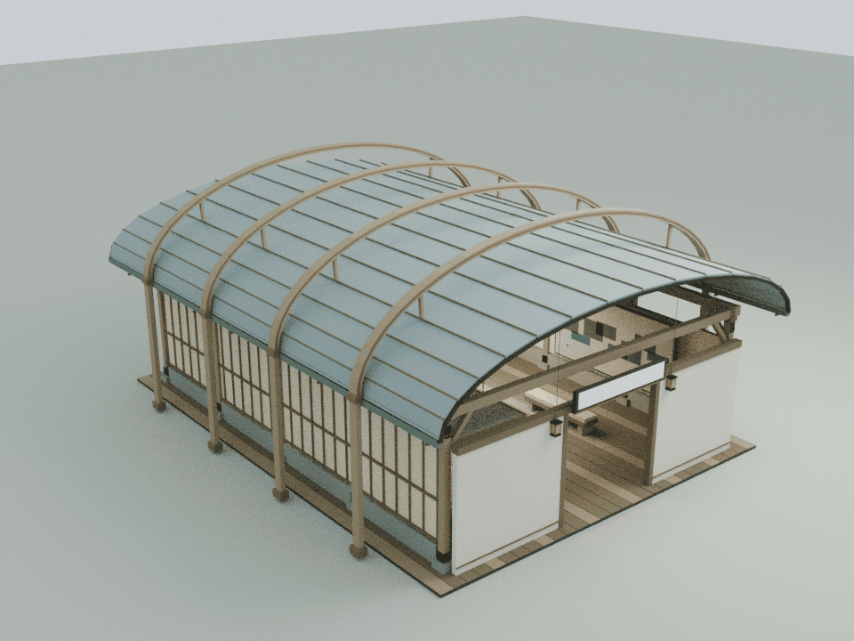
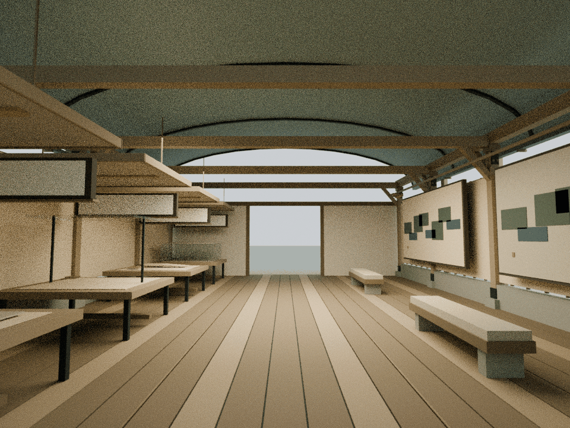
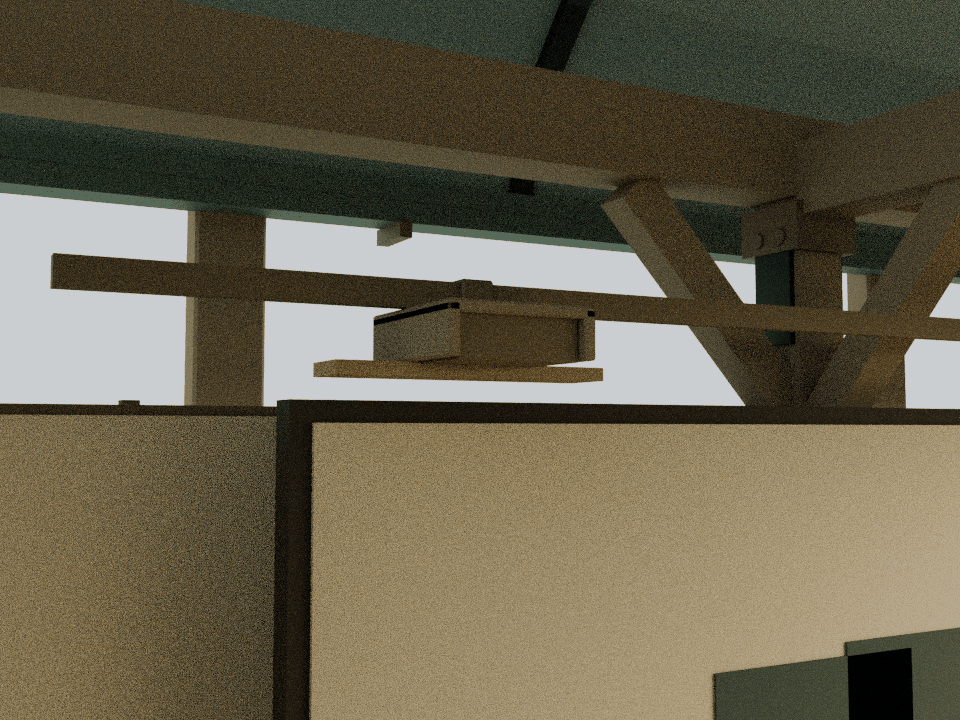

# 墨生：四道护拱与完整画面的回看

本轮仅细化 building3，基线为已发布的 `685a2a603b94986c48927cfc832d66d57fe39c3e`。内容依据 `assets/readings/3.json` 和原建筑的微吸去尘、无接触成像、纸张补缺、间接润展四个浅工作湾。完整的前后画面始终保留，观察灯沿原侧向滑轨回访整个过程。

## 内容与实体

- 四道连续木护拱分别对应四个工作站，包在保留的陶色拱顶外。主木拱配极窄铜线，保持浅木、灰绿陶色与克制金属的庭院配色
- 每道拱的内外椭圆分别为半宽7.88/8.08 m、抬高3.75/3.95 m，起拱高5.25 m，沿长度厚34 cm；24段闭合实体具有完整内外表面、前后面与端盖
- 八根外侧立柱、底靴、起拱夹件和短顶撑连接完整护拱。为防穿柱，增加八个只包住新外柱及底靴的碰撞盒；原碰撞项完整保留，中央通行不变
- 四个原浅光罩增加木缘和吊杆夹件，四张原工作台各增一个小型工具托盘。原工序用品、画面、工作台和观看位置保持
- 原观察光增加两侧木颊、顶盖和铜悬挂眼，保持13 m行程及原运动公式。木颊与顶盖避开原轨，只有指定铜悬挂眼与轨形成设计接合

## Blender与运行时

    blender -b -t 2 --python tools/model-restoration.py
    node docs/restoration-detail-check.cjs
    node docs/restoration-regression.cjs
    node docs/detail-lod-check.cjs
    blender -b -t 4 --python tools/render-restoration.py

静态80个构件、4,736三角面；活动观察灯4构件、176三角面。合计4,912新增三角面、4个材质批次，gzip约29KB，明显低于上一轮单馆预算。固定与活动原型按材质合批并缓存共享。

`CourtyardRestorationDetail.attach(b)` 与 `attachLight(b,inspection)` 分别挂到原建筑和原观察灯节点。生成的真实三角网格直接用于Three.js；本地可编辑源为 `qa-results/restoration/restoration-detail.blend`，实际运行时CPU装配为 `restoration-runtime-assembly.blend`，均不提交仓库。

## 验证

- 实际运行时八个拱形实体（四木拱、四铜线）的闭合拓扑、独立椭圆公式、正体积与368条截面射线通过
- 八状态536个原网格/实例及材质、矩阵保持，其中359个低位构件保持；原轨、完整前后画面与原机构公式未改
- 原固定实体与新增固定实体的活动检测通过；只允许指定铜悬挂眼与原轨接合。保守世界AABB与一根旋转斜撑重叠，精确局部实体检查确认分离，并未把AABB重叠算作真实穿插
- 七个文字平面的504条视线、完整画面400条视线与主通道603条净空射线通过
- 累计性能统计与本轮远距细节减负见 `DETAIL_PERFORMANCE_BUDGET.md`。远处只隐藏新增的小型活动附件，保留原机构和全部建筑轮廓/替换屋面

发布清单62项哈希与41个入口缓存版本已逐项核对。65个资产JS与验证CJS文件、23段非空内联脚本语法通过；完整整院套件34项可运行检查中33项通过；唯一失败是已核对的基线wave1旧LINKS哈希断言，发生在浏览器启动前。两项Mac Chrome导航脚本明确未运行。

浏览器GPU、实际移动端帧率与触控未经本轮实测；两项依赖Mac Chrome的导航脚本未运行，既有浏览器权限限制未绕过。

以下为实际运行时装配导入Blender的CPU审阅图，并非网站截图。Canvas文字与木纹贴图未烘焙，图像用于检查护拱、通道、工序浅湾和观察灯间隙，不构成实体结构认证。

