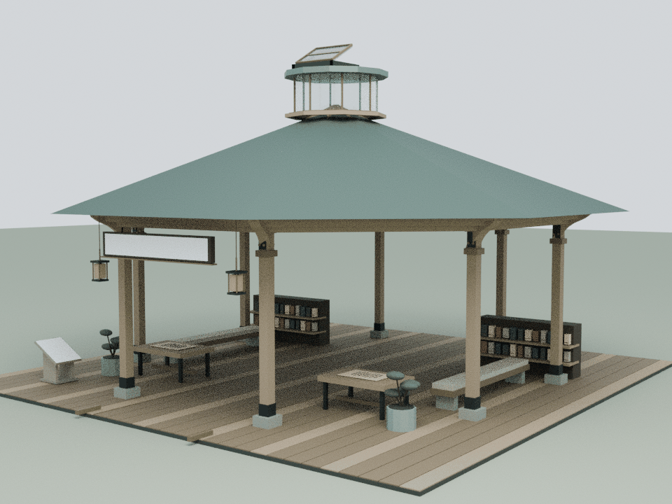
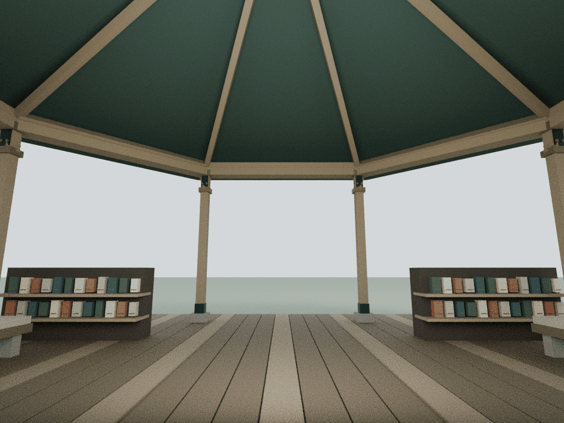
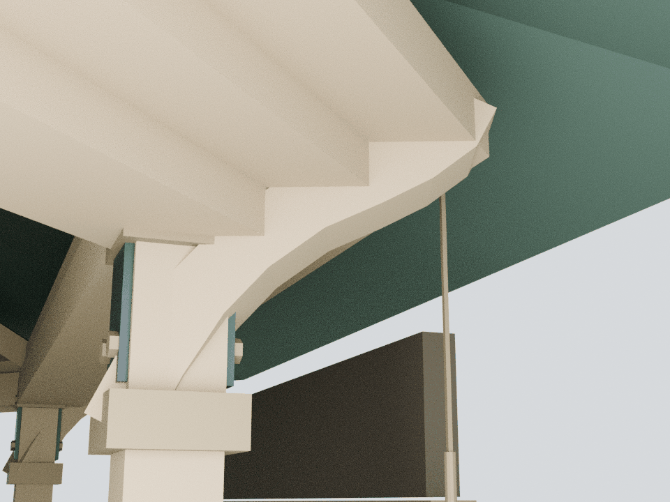

# RSS：八角门亭的叠檐与放射构架

本轮仅细化 building8，基于已发布的 `fc5775a2f5237ccd0f29450702716bf7ec0fcc2d`。最终生产路径仍使用 `assets/architecture.js` 的八角开敞亭，服务内容脚本没有覆盖此馆。

## 已知内容与设计边界

`assets/readings/8.json` 的三个章节只确认 WeWe RSS 的公开入口、公众号源与账号管理导航，以及 AuthCode 访问限制。没有进入账户、订阅或文章页面。本轮用八角亭的开敞入口、放射承托与集中灯亭强化建筑识别，不把这些造型解释成已验证的推荐、更新、筛选或聚合流程。

原有通用书架、桌面与纸面保留，不增补虚构报刊、账号或订阅内容。原服务链接、内嵌阅读与访问边界文字保持不变；庭内不收集 AuthCode，也不模拟登录。

## 模型与审阅

建模脚本、运行时网格与检查脚本随仓库保存；可编辑 Blender 源和完整运行时装配留在本地 `qa-results/rss/`。三张图使用实际运行时网格进行 Blender CPU 审阅。Canvas 文字纹理不在离线装配中烘焙，文字通过源文件与绘制回归核对。离线审阅不替代浏览器交互、GPU 帧率测试或实体结构认证。

## 构件与重建

    blender -b -t 4 --python tools/model-rss.py
    node docs/rss-detail-check.cjs
    node docs/rss-regression.cjs
    blender -b -t 4 --python tools/render-rss.py

新增21个闭合实体、1,120三角面、橡木与铜色2个共享批次：三层八角檐环、八道连续曲托、八个真实空心柱套，以及两层开口灯亭座圈。檐下19件沿原环梁、立柱与柱脚接合。上方两件座圈接在既有灯亭铜色竖杆上；原灯亭本来是独立上部装配，本轮没有将这点解释为已经证明的完整落地承重路径。

运行时仅在建筑8调用 `CourtyardRSSDetail.attach(b)`。原装配完成后追加网格并更新实际包围盒，避免改变原布局、悬灯吊线或阅读停点。没有新增屋顶薄皮、运动构件或运行时灯光。

## 验证

独立审计验证21件闭合体、2,960条截面射线、32,272对自交检测与59处有限体积接合，并确认八组原梁→柱→柱脚接合。7,952,000对新旧面和134,144对新增面检测没有正面积共面重叠。375个原网格/实例、40个碰撞体、原材质、组、灯光、Canvas文字及动作在8个姿态逐值保持；完整装配为377个网格/实例。

原八面锥形屋顶以实际三角面检测，新增构件最小净距106.05 mm；两处玻璃最小净距25.00 mm。原活动天窗采用全行程连续包络并保留25 mm余量。3.6 m直行通路、2.4 m身体空间、阅读停点、两块文字面的完整视域与三个阅读章节保持。图审只调整相机和离线柔光，没有改写运行时灯光。

本轮资产105,421字节原始 / 12,255字节gzip-9（沿用Node zlib计量）。累计23馆新增153,672三角面 / 141批次；整栋装配合计528,626三角面 / 1,137批次。23馆detail合计9,535,658字节原始 / 1,024,547字节gzip-9。B8从7,050面 / 35批次变为8,170面 / 37批次；前22馆预算逐栋不变，原远距LOD节省7,568面 / 60批次保持。

整院61项明确列出的CPU检查全部通过，121份JS/CJS、49份Python AST和40段HTML内联脚本语法通过，175项独立来源保全通过。413项源文件捕获并核对，执行期间模型、代码、测试和数据不变；仅两份说明文档在最终汇总后更新。最终生产顺序中23馆精修组各挂载一次，76项发布manifest和两入口各55项缓存版本一致。月雪铺地修复与匿名文本、强化蝶及前22馆保留。未执行或语法解析Mac专用导航runner；wave1旧导航哈希差异仅作基线记录，不算新增失败。
