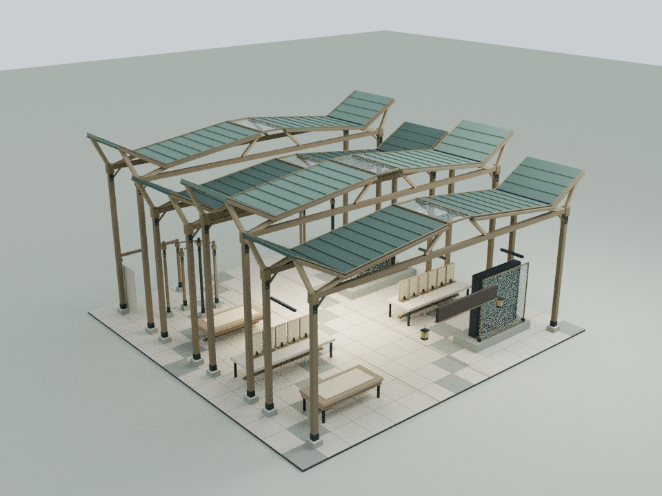
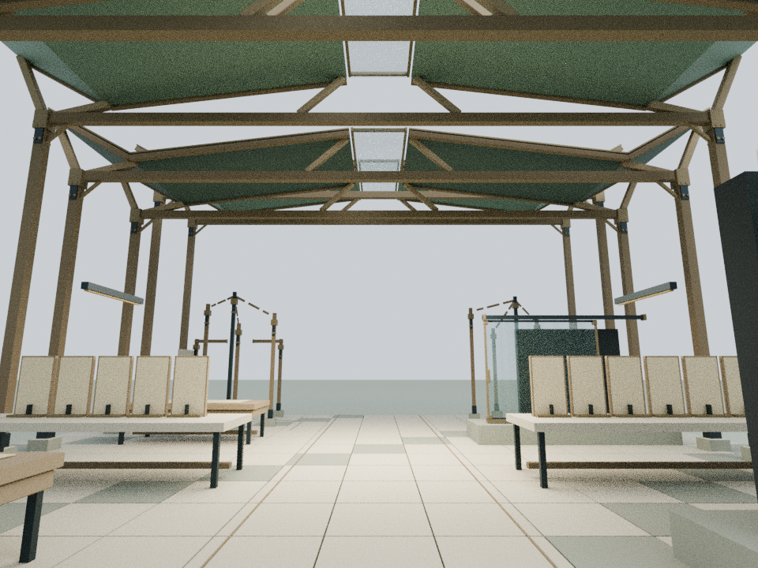
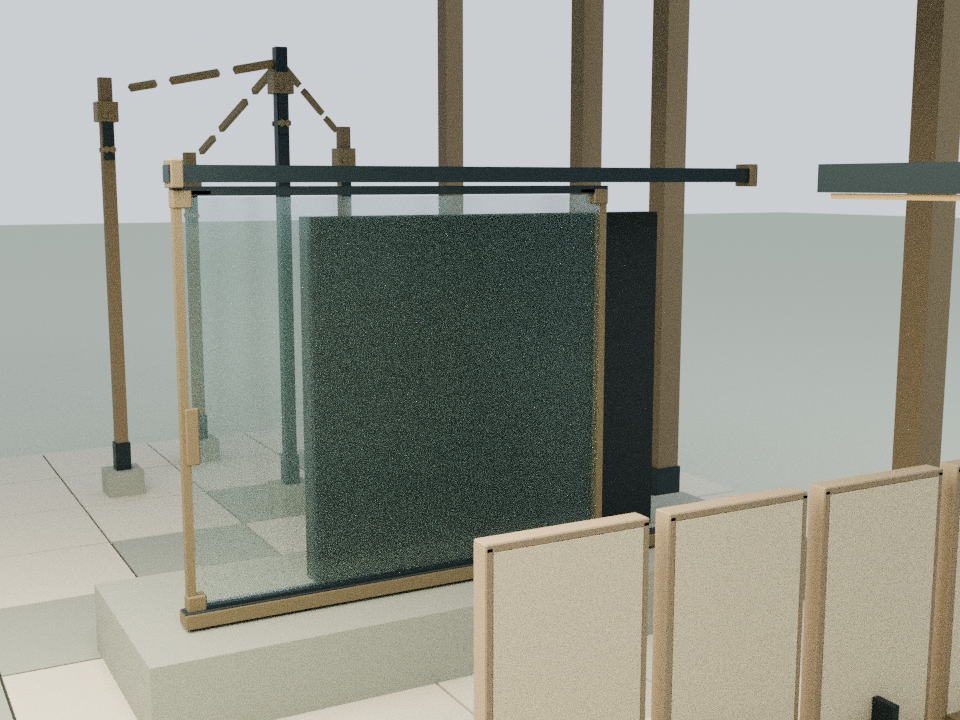

# 碑拓研究馆：原件、比照与未决

本轮只细化 building22，以已经发布的 `7910ab80772cbe494be7d2b5dd3e055aa91056ee` 为基线。保留既有公开内容、阅读入口、铭文、机械蝶和所有其他建筑。

## 内容与空间

依据庭院已有 `assets/readings/22.json` 及原建筑的来源说明，四段空间仍分别对应原件保护、十一份参照、可逆比照层与未决关系。新增构造只加强这些既有含义，不添加碑文、识别结果或历史结论。

- 四段屋顶改成有厚度的折叶屋盖，高低交替；柱头分叉撑杆、木檐边、铜压条和中轴采光缝形成可读的连接
- 高低变化服务于空间节奏，不暗示证据可信度逐级上升
- 原件保持空白、固定，保护玻璃增加独立边框；十一份参照保留原尺寸、同一高度和原有位置，增加一致的细框与斜撑
- 桌下围边留在原工作台范围；比照层的角码、导向块和齐平握把挂在原活动节点上
- 运动仍是原来的 0.96 m 横移；全部新增活动构件都留在既有扫掠保护范围内
- 关系提案仍断开，未决龛上方的缺口仍存在；端部收口强调断点，没有把它补成完整连接
- 3.6 m 中轴与原有侧向参观路径保持不变

## 实际模型与重建

`tools/model-rubbing.py` 在 Blender 中生成338个静态构件和7个活动构件，共14,668个三角面、9个运行时材质批次。资源约910 KB原始文本，gzip约91 KB。这里是细化资源面数，并非替换旧屋顶后的净增面数。

16片折叶屋盖都是竖向16 cm厚的闭合实体。四段门架高度为7.05、8.30、7.40、8.70 m；完整装配最高约10.75 m。原有展品与文字不随屋顶高度改变。

    blender -b -t 2 --python tools/model-rubbing.py
    node docs/rubbing-detail-check.cjs
    node docs/rubbing-regression.cjs
    blender -b -t 4 --python tools/render-rubbing.py

可编辑细化源保存为 `qa-results/rubbing/rubbing-detail.blend`，构件通过 `runtime_section` 区分静态与活动部分。`rubbing-runtime-assembly.blend` 由实际Three.js网格和实例矩阵导出，包含原建筑及展开状态的比照层。仓库保留可重建脚本与审阅图，不提交这些本地模型或临时测试产物。

`CourtyardRubbingDetail.attach(b)` 将静态部分挂到建筑根节点；`attachOverlay(b, parent)` 将活动部分挂到原 `reversible-readability-overlay`。资源必须先于 `content-literary.js` 加载。几何缓存可跨建筑实例共享，活动节点保持独立。

## 验证

- 新几何坐标与法线有限，无退化三角面；生成器验证16片屋盖的闭合边及正体积
- 96次实际屋面上、下射线验证折线轮廓及16 cm厚度
- 663个中轴样点按0.38 m身体半径验证碰撞，303条实际网格射线检查新增结构净高
- 八种反复切换状态验证原0.96 m运动公式、扫掠保护范围与刚体比例
- 511个原有低位网格/实例逐值比较基线，包含原件、十一份参照、原比照层、断开的关系提案与未决龛；八种状态全部保持
- 其他24栋标准建筑及3栋基础设施的实际几何、材质和碰撞保持；25个机构名称与原有运动状态比较通过
- 阅读正文、目录、阅读面板、动作、庭院运行逻辑及机械蝶源码/原模型保持基线字节一致
- 全庭28栋静态检查、阅读/铭文、月雪、暖聆、排版助手、路线和手机布局源码等回归通过
- 共23项Node脚本检查，22项通过；唯一失败仍是基线已有的 `wave1-check.cjs` 旧LINKS哈希断言，发生在浏览器启动之前，本轮LINKS未改变
- 两份入口完全一致；原55项发布清单保留，新增细化资源后56项哈希全部通过，缓存版本同步

## 证据范围

本轮没有启动浏览器，也没有绕过已确认的Chromium权限限制。浏览器GPU、真实触控和手机帧率未经本轮实测。可打开 `docs/rubbing-detail-qa.html` 查看独立Three.js装配；此文件是后续浏览器审阅入口，不代表已经完成浏览器验证。

以下三张图为960×720的Blender CPU审阅渲染，文字Canvas与木纹贴图未烘焙，不是网站截图。它们用于检查外形、构造连接与空间间隙，不构成结构承重或实体设备安全认证。审阅图片独立于庭院入口加载。

