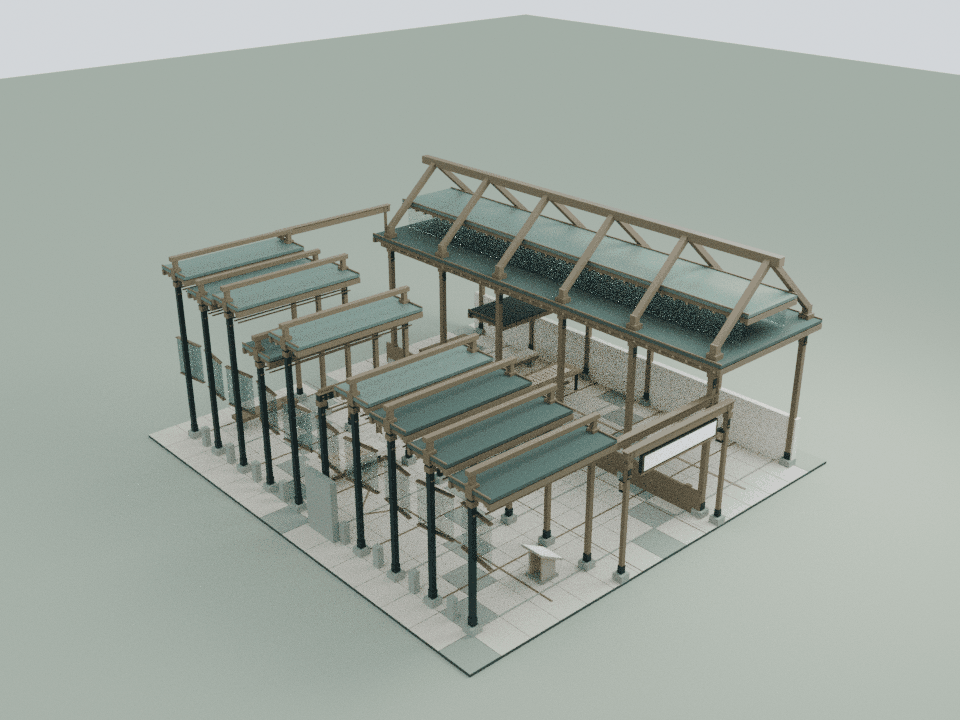
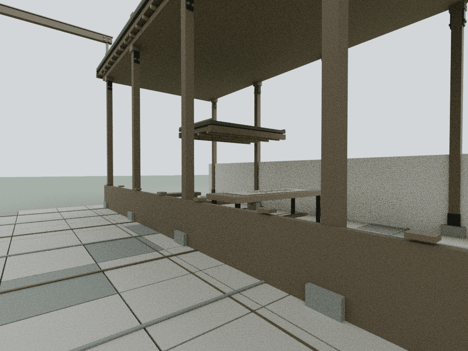
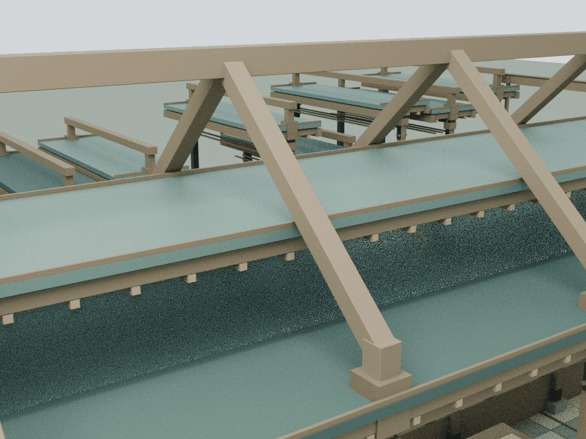

# AI 两年：连续的人与断续的工具层

本轮只细化 building13「与 AI 同行的两年：一份 session log」，基于已发布的 `84b26b5b79f14eb0f390ac3f9b38fc519ef72141`。依据仓库既有、经过隐私处理的 `assets/readings/13.json`，保留十段session及原卷首、来源说明。建筑解读不添加个人判断、对话或未经原文支持的身份结论。

## 内容与构造

原建筑已用左侧连续木灯脊和右侧十个不等高工具段，表达人的本心与不断增加的工具层。本轮加强这种不对称：连续主线具有可辨认的木质轮廓，工具段保留分隔和构造接合，不把整个过程做成越走越高的凯旋阶梯。

第五段“第一次自我复制（失败）”留下的屋面缺口继续敞开，疲惫处的低顶休息位维持人的尺度；末端的 whoami 仍是开放的问题。十块原透明工具面板的旋转和透明度变化继续使用原机制，人的连续墙与伦理边界栏始终不变。

## 模型与重建

    blender -b -t 2 --python tools/model-session.py
    node docs/session-detail-check.cjs
    node docs/session-regression.cjs
    node docs/detail-lod-check.cjs
    blender -b -t 4 --python tools/render-session.py

本轮共82个闭合实体、2,384三角面，雪松与铜色2个静态批次。左侧12根短柱延伸承接原柱，成对开放斜杆托起一条20.1 m连续木脊；右侧仅在原有屋面上形成9个独立框口，保留原不等高顺序。空心套筒包覆实际穿檐位置，斜杆避开原灯脊玻璃、铜盖及其细包边。近景审阅后，斜杆侧面各内缩10 mm，工具框头侧面各外挑20 mm；60处真实接合面检测确认错台，消除原先新构件之间的共面黑斑。

实际 Blender 三角网格由 `assets/session-detail.js` 接入。`assets/content-narratives.js` 只在 building13 增加一个 `CourtyardSessionDetail.attach(b)`；新增组在原布局完成后挂入，原 width/depth 与阅读位置保留，实际包围盒和高度包含新构件。

可编辑模型和运行时装配留在 `qa-results/session/`，大模型不提交仓库；仓库保留生成脚本、运行时网格及三张代表审阅图。累计预算见 `DETAIL_PERFORMANCE_BUDGET.md`。

## 检查与限制

独立审计从实际三角网格恢复实体，核对闭合性、尺寸、正体积接合和屋面落脚。原网格、材质、文字、碰撞和完整工具层运动与真实发布基线逐值对照；通行采用连续身体净空，阅读采用完整文字视域。

独立审计恢复82个朝外闭合流形实体，5,262条截面射线核对完整构件与空心套筒；132处正体积接合使全部新构件接入原建筑。44个原灯脊玻璃、上层屋面及包边构件完成104,896次新增三角排除检查，确认没有穿入。

1,146个原网格/实例及材质、Canvas文字、碰撞和动作在8个状态逐值保持；12个阅读章节和3个阅读相位保持。30个活动构件的连续旋转包络完成71,520次三角检测，保留25 mm新增构件净空。17段连续2.4 m身体空间完成351,900次三角及1,768次碰撞体检测；失败缺口、休息凹室和未封闭末端另以完整空间核对。

整院51项CPU检查通过；71项发布manifest、50项入口缓存版本一致，105份JS/CJS、39份Python和35段HTML内联脚本语法通过。前17馆预算逐行保持；累计18馆新增146,456三角面 / 131批次。本轮资产192,544字节原始 / 20,811字节gzip-9。

检查使用显式云端CPU列表，两个Mac Chrome导航脚本不执行；旧wave1哈希前置状态单独与本轮基线比对。下图是实际运行时装配的Blender CPU审阅图，Canvas文字与纹理未烘焙，不替代浏览器交互、GPU帧率或实体结构认证。

