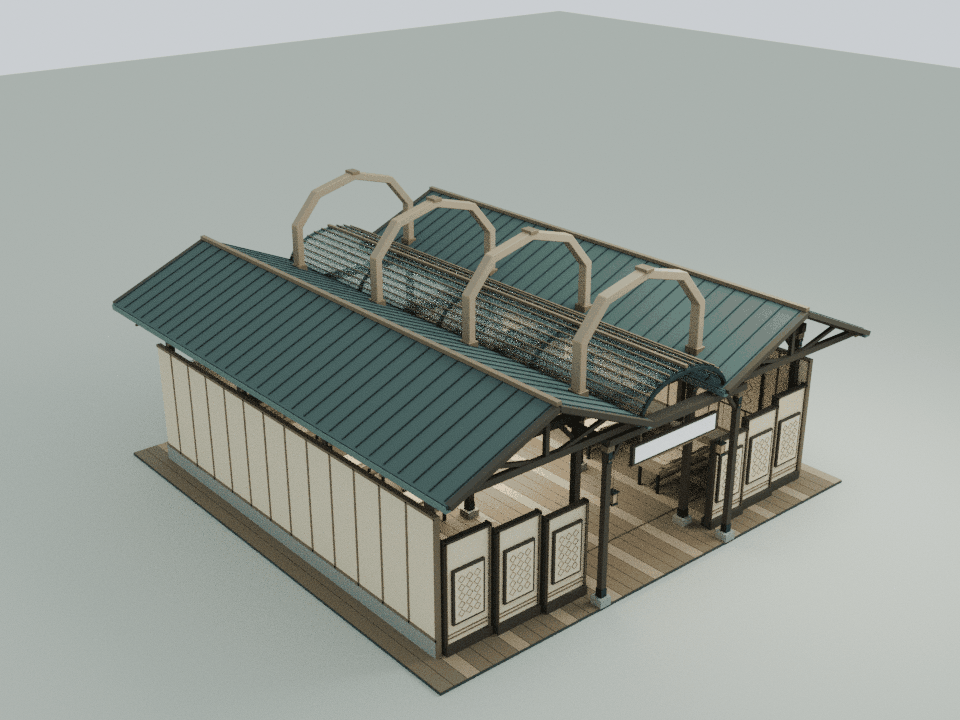
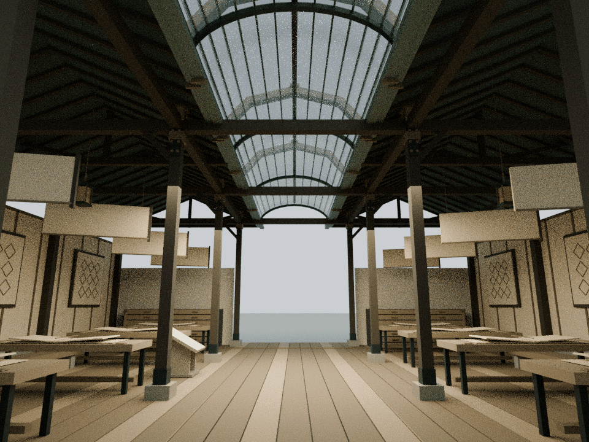
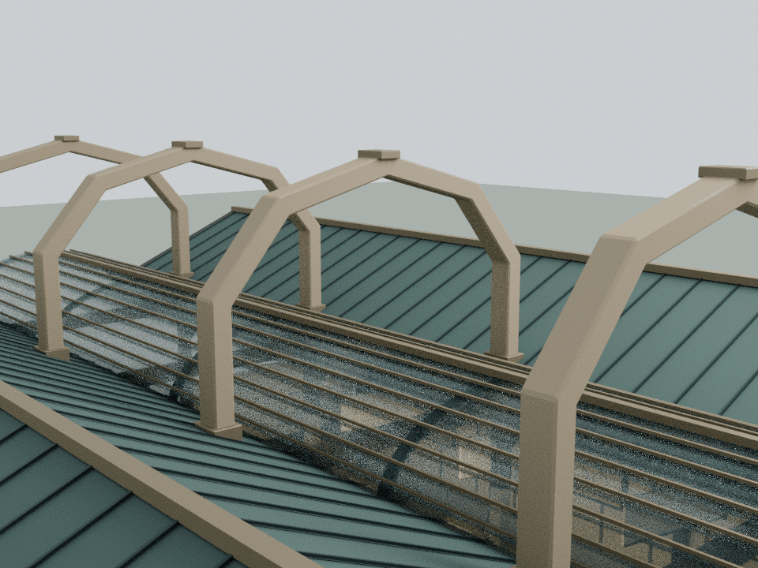

# 金陵专利局：四道册页缝合肋

本轮仅细化 building7，基线为已发布的 `603d27c49075c6139da63d8c114e1120e4bcfc91`。依据 `assets/readings/7.json` 已核对的 IPShield 四阶段工作台：关键词录入、技术分类、专利检索、生成鉴定书。两侧专利与商标材料最终回到同一项目档案。正文、固定示例与产品范围说明保持原样，没有增加专利号、风险分数或法律结论。

## 形体与细节

- 四道连续闭合木质缝合肋沿原四组承重框架排列，越过中央册脊玻璃顶。最高10.4 m，断面向两端回落，轮廓对应四个工作阶段
- 两脚接在原x±2.8 m的框架梁头，穿过原斜屋面的位置设置铜套；原双坡瓦面、玻璃拱顶和铜色册脊完整保留
- 四个顶部铜箍使缝合肋可读作连续装订关系，而不是额外信息招牌
- 八张原册页工作台增加低矮边夹；后部两个七层档案柜增加护边和包角。所有低位新增构件保持在原家具轮廓范围内
- 八片原高位翻页保留原有分阶段运动，不增加活动节点或批次

## 模型与运行时

    blender -b -t 2 --python tools/model-shield.py
    node docs/shield-detail-check.cjs
    node docs/shield-regression.cjs
    node docs/detail-lod-check.cjs
    blender -b -t 4 --python tools/render-shield.py

Blender生成44个实体、2,384个三角面；仅木、铜2个静态材质批次。连续肋由真实多边形实体挤出并倒角，不由相互重叠的小杆近似。运行时使用同一Blender三角网格，无额外模型加载器。

`assets/content-services.js` 只增加一个 `CourtyardShieldDetail.attach(b)` 挂接点。本地源模型在 `qa-results/shield/shield-detail.blend`，运行时装配在 `qa-results/shield/shield-runtime-assembly.blend`；大模型不入仓库。原建筑细节远距LOD继续生效，新增静态轮廓在远处保持。

## 审阅范围

几何、原网格/材质/实例、原运动、通行与文字视线的独立回归见两项shield检查；全庭累计资源见 `DETAIL_PERFORMANCE_BUDGET.md`。新增肋脚与原框架梁、斜屋面及铜套的接合为有意的支承连接，不被当作可通行空间。

独立几何检查确认44个闭合实体；八个肋脚与原横梁/纵梁分别有4 cm/8 cm的支承重叠，斜屋面穿透高度6.586–6.902 m落在铜套6.55–6.99 m内。9,984次玻璃顶三角相交检查通过。八片翻页采用完整转角范围的解析包围盒并保留25 mm间隙，共57,216次检测通过；八段连续76 cm宽、2.25 m高的人行净空棱柱完成222,240次三角检测。完整匾额和书案阅读视域4,768次、八张桌面书写区域19,072次检测通过。包含真实阅读台的1,880个原网格/实例在八个运动状态逐值保持。

整院递归检查39项通过；1项wave1为已核对的基线旧LINKS哈希失败；另2项为上述环境启动中止。83个JS/CJS/Python文件及31份HTML中的27段内联脚本语法通过；发布清单65项与入口缓存44项逐项核验通过，另外24栋标准馆和3项基础设施、109个保留资产与基线一致。

以下是实际运行时装配导入Blender的CPU审阅图，不是网站截图。Canvas文字与木纹贴图未烘焙。浏览器GPU帧率和移动端触控未实测；既有浏览器权限限制未绕过。递归检查误包含两项依赖Mac Chrome的脚本，均在本云环境尝试启动硬编码应用路径时以ENOENT退出，没有启动浏览器或执行导航断言，未重试。这些模型表达不构成实体结构认证。

