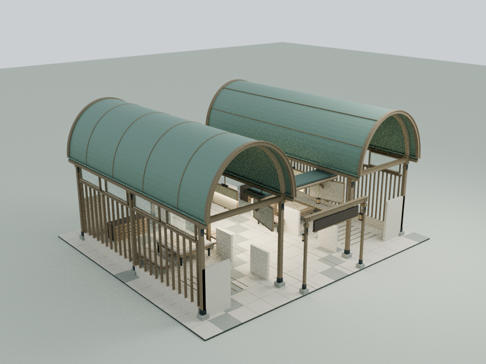
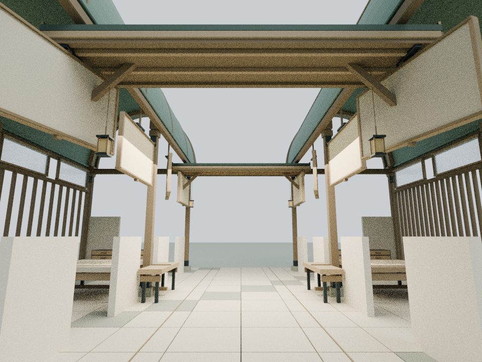
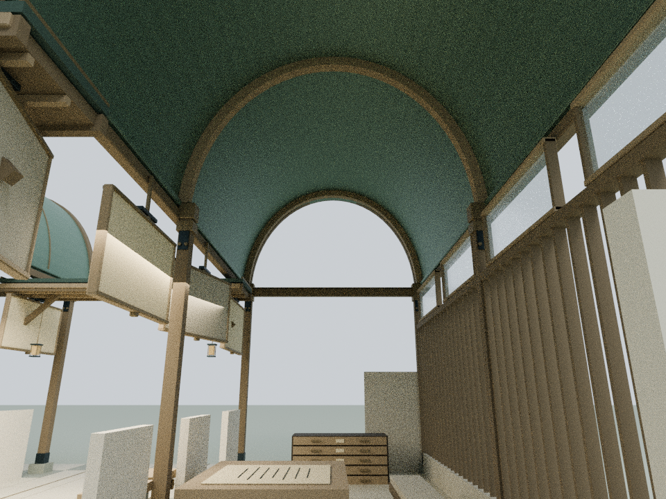

# 双星记：平等的双拱与共同空场

本轮只细化 building17，以已发布的 `f284106f4c7cba7e4bd7d8fa7befa641865c80ec` 为基线。内容依据庭院已有的 `assets/readings/17.json` 和建筑来源说明。两个房间仍各自成立，共同中心保持开放；没有增加人物评价、星体装饰或新的叙事结论。

## 内容与构造

- 两座房间采用相同跨度、进深和高度的闭合铜质筒拱；一侧纵向立缝、另一侧横向立缝，用不同加工方式表达对等中的差异
- 原有柱子全部保留。三道连续橡木拱肋落在原柱列位置，顶部贴合屋盖下皮；入口的深木拱框和细铜嵌边让双拱轮廓清楚可读
- 只替换原筒拱总成及遮挡拱腹的平顶板。其他原有几何、材料、位置和碰撞保持，包括侧光槽、室内工作台、纸面、坐席、柜体、短连接和公共工作边
- 原四对高位屏风增加细木框、转轴套和滑动舌片，仍挂在原八个活动节点上；固定头轨容纳原有往返动作
- 运动保留原公式：角度幅值0.27 rad、前后位移幅值0.19 m，左右互相回应；没有把任何一侧固定为主导
- 中轴仍可独立贯通；两房前后入口各自成立，不要求两位玩家同时在场

## 实际模型与重建

`tools/model-twinstars.py` 在 Blender 中生成116个静态构件和7个屏风局部原型构件。原型用于八扇屏风，运行时细化资源合计11,888个三角面、21个材质批次，原始文本约595 KB、gzip约57 KB。这里是细化资源的面数，不是替换旧屋盖后的净增面数。

两座铜拱中心分别为x=−6.3 m与x=6.3 m；每座宽6.55 m、深16.6 m、起拱高度6.27 m、矢高3.90 m、顶面最高10.17 m。每座采用32段椭圆弧，竖向厚度16 cm，闭合侧边与端面。拱肋外缘与下皮采用同一曲线，入口木框与铜嵌边略高于主屋面。

    blender -b -t 2 --python tools/model-twinstars.py
    node docs/twinstars-detail-check.cjs
    node docs/twinstars-regression.cjs
    blender -b -t 4 --python tools/render-twinstars.py

可编辑细化源为 `qa-results/twinstars/twinstars-detail.blend`，用 `runtime_section` 区分静态装配与局部屏风原型。`runtime-assembly.json` 导出769个实际运行时网格/实例，包含原建筑与phase=1的屏风；`twinstars-runtime-assembly.blend` 由该导出重建。仓库保留生成、验证、渲染脚本和审阅图，不提交本地模型及临时测试产物。

`CourtyardTwinstarsDetail.attach(b)` 把静态部分挂到建筑根节点；`attachScreen(b, parent)` 把局部原型挂到各自原屏风节点。资源先于 `content-narratives.js` 加载。几何缓存跨实例共享，八个屏风及不同建筑的活动节点保持独立。

## 验证

- 所有新网格坐标与法线有限，无退化三角面；总细化三角面低于20,000预算
- 从实际铜材质网格中分离出两座完整屋壳，各260个三角面、132个顶点、390条边；每条边恰由两面反向使用，体积为正
- 实际顶点匹配32段椭圆弧；平移后两屋壳的顶点集合一致，跨度、进深、起拱高度、矢高和厚度一致
- 140次实际屋盖上下射线验证16 cm厚度；另84次射线验证六道木拱肋与屋盖下皮接触
- 八种反复切换状态检验全部八扇屏风的原角度和位移公式、有限变换、刚体比例及独立侧边；64个扫掠包围盒最低约3.645 m
- 510个原低位网格/实例逐值对比未修改基线；所有748个非屋盖原网格/实例对比只删除两条获准屋盖调用的隔离基线。全部八种状态保持，包含原柱、原屏风和室内展陈
- 原碰撞列表完整一致；15条完整直线段按身体半径精确检测水平包围盒，另663个中轴身体样点和720个两房前后入口样点按0.38 m身体半径检查，1,383条实际装配射线检查低位净空
- 其他24栋标准建筑和3栋基础设施的实际几何、材质和碰撞在八种状态下保持；25个机构名称及原有动作保留
- 全部阅读JSON、阅读目录/面板、建筑动作、庭院运行逻辑、其他建筑源码、机械蝶源码和原GLB字节保持
- 全入口源码仅允许新增细化脚本和缓存版本；叙事建筑源码仅允许两条原屋盖调用的替换及两个细化挂接点
- 共25项Node脚本检查，24项通过。唯一失败为基线已有 `wave1-check.cjs` 的旧LINKS哈希断言，发生在浏览器启动前；本轮LINKS与已发布基线完全一致
- 两份入口完全一致，原56项发布清单全部保留，新增细化资源后57项哈希和36个入口缓存版本通过；JavaScript/内联脚本语法及 `git diff --check` 通过

## 证据范围

本轮没有启动浏览器，也没有绕过已确认的Chromium权限限制。浏览器GPU、真实触控和手机帧率未经本轮实测。`docs/twinstars-detail-qa.html` 是后续独立Three.js装配的浏览器审阅入口，不代表已完成浏览器验证。

下列三张图为960×720的Blender CPU审阅渲染，文字Canvas与木纹贴图未烘焙，并非网站截图。它们用于检查双拱轮廓、拱肋贴合、屏风构造及空间间隙，不构成结构承重或实体设备安全认证。审阅图片独立于庭院入口加载。

