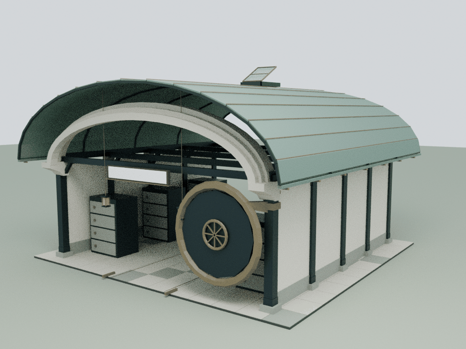
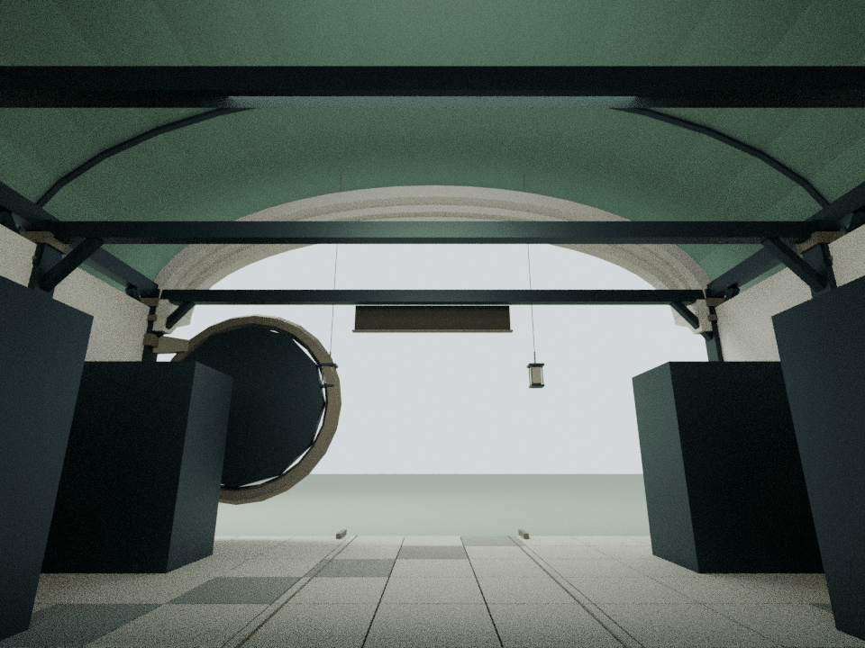
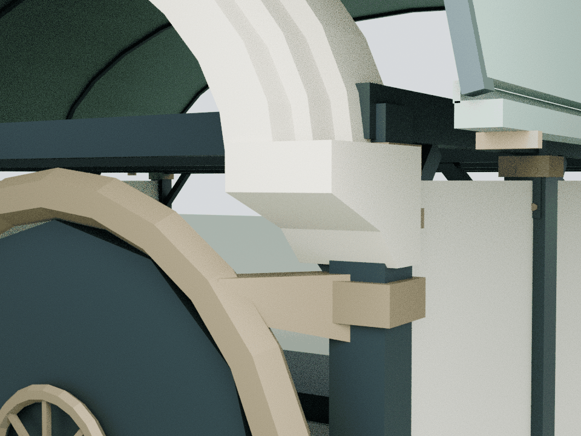

# Vaultwarden：开敞通道与分层拱廊

本轮仅细化 building9，基于已发布的 `3582ae56650a925bd16c6a4b7a4b4288736393a6`。最终生产路径是 `assets/architecture.js` 中的原桶拱建筑，服务内容脚本没有覆盖此馆。

## 内容边界

现有 `assets/readings/9.json` 只收录公开的邮箱优先登录入口与产品身份说明，明确区分 Vaultwarden 与 Bitwarden 官方服务。本轮没有访问账户、读取凭据或研究内部项目。内嵌三个阅读章节、原链接及访问说明保持。

分层拱廊与侧置圆轮强调建筑入口的深度和边界。它们是建筑表达，不是对真实系统安全性、加密能力、保管或共享功能的验证。原柜体继续作为既有建筑陈设保留；不增加示例秘密、密码输入框或模拟登录成功。

## 模型与审阅

可编辑 Blender 源和完整运行时装配留在本地 `qa-results/vault/`。仓库保存生成脚本、实际运行时网格与三张压缩审阅图。离线装配保留全部原始与新增几何；Canvas文字像素不烘焙，文字通过源文件与绘制回归核对。CPU审阅不替代浏览器交互、GPU性能测试或实体结构认证。

## 构件与重建

    blender -b -t 4 --python tools/model-vault.py
    node docs/vault-detail-check.cjs
    node docs/vault-regression.cjs
    blender -b -t 4 --python tools/render-vault.py

新增9个闭合实体、736三角面，仅石灰石与铜色2个共享批次：三道有实际厚度的退台椭圆拱、两块承托拱脚、三只真实空心柱套，以及圆轮后方的静态侧向承托。最低新增几何在4.23 m，保留3.6 m中央直行空间。圆轮不移动，也不增加门锁动作。

原柱宽420 mm；新柱套内孔由初稿400 mm缩至396 mm，每侧形成12 mm接合，同时避开原侧墙端面的共面重叠。这项修正只改变新增柱套。拱脚接在原钢柱，三道拱分别搭接拱脚与相邻拱层，圆轮承托连接原柱与原圆轮外缘。

唯一建筑9调用为 `CourtyardVaultDetail.attach(b)`，延迟到原布局与悬灯完成后附加网格并更新实际包围盒。模型重建输出逐字节一致；完整547网格/实例装配也经两次独立构建核对。

## 验证

独立审计核对9个闭合实体、1,784条截面射线、59,264对自交检测与16处有限体积接合。6,626,944对新旧面、102,016对新增面检测均无正面积共面重叠。545个原网格/实例、32个碰撞体、原材质、组、灯光、Canvas文字与动作在8个姿态逐值保持。

20处实际屋顶/檐沟构件完成176,640次三角检测，最小净距923.92 mm；原活动天窗全行程保持25 mm余量。2.4 m身体空间、中央通路、阅读停点、两块文字面完整视域与三个阅读章节保持。新QA页另校准滑杆的归一化进度，沿用原天窗运动公式，不改生产动画。

资产55,393字节原始 / 7,730字节gzip-9（沿用Node zlib计量）。累计24馆新增154,408三角面 / 143批次，整栋装配合计538,352三角面 / 1,164批次；24馆detail合计9,591,051字节原始 / 1,032,277字节gzip-9。B9从8,990面 / 25批次变为9,726面 / 27批次；前23馆预算逐栋不变，原远距LOD节省7,568面 / 60批次保持。

整院63项明确列出的CPU检查全部通过；124份JS/CJS、51份Python AST与41段HTML内联脚本语法通过，178项独立来源保全通过。423项源文件捕获并核对，模型、代码、测试、QA与预览执行期间不变，只有本说明文档补充最终汇总。最终生产顺序中24馆精修组各挂载一次，77项发布manifest和两入口各56项缓存版本一致。月雪匿名内容及铺地修复、强化蝶和前23馆保持。未执行或语法解析Mac专用导航runner；wave1旧导航哈希差异仅作基线记录。
