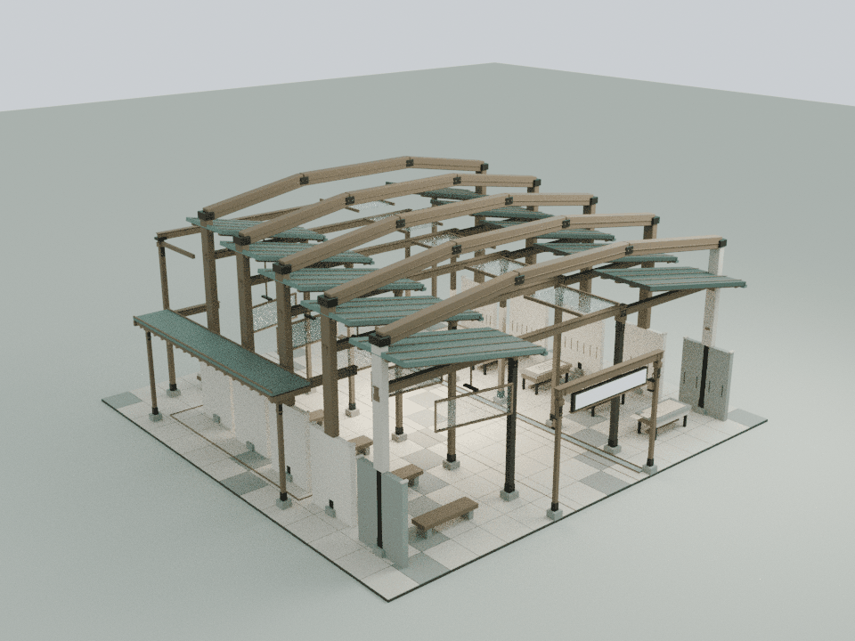
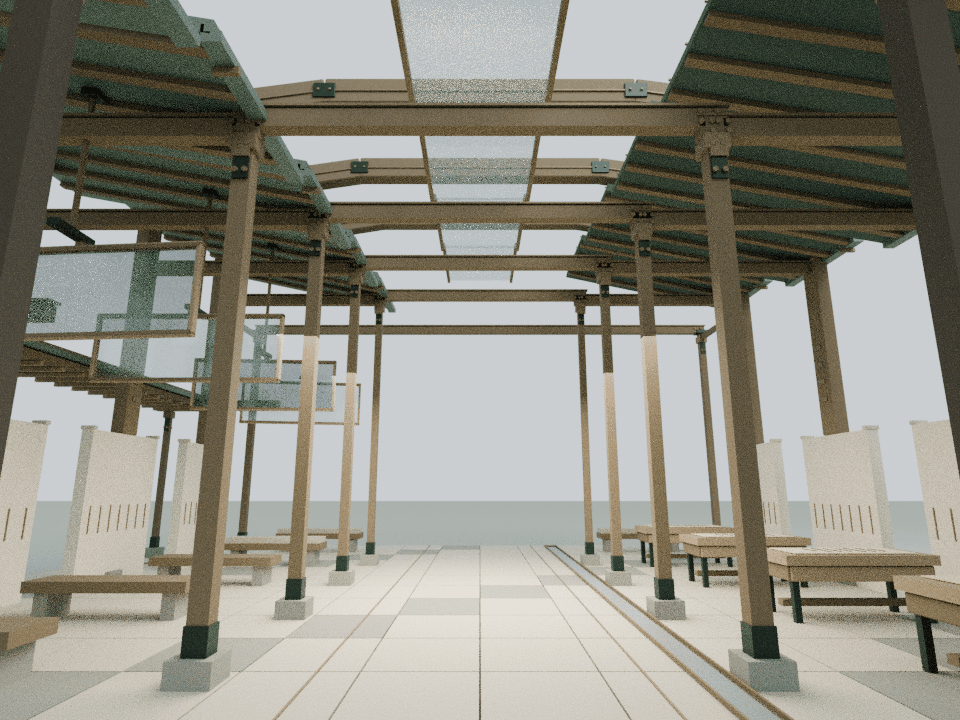
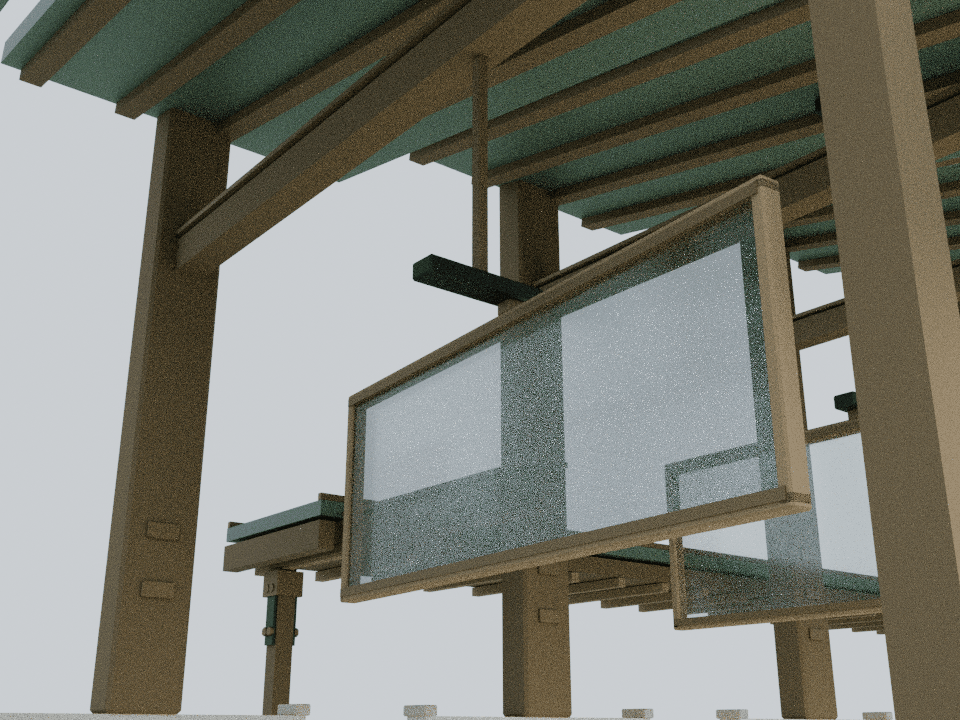

# 思想者的五个版本：保留旧稿的五道门架

本轮仅细化 building18，基线为已发布的 `0b34816b05cfd24f20ead68d33735869f7cc5ecc`。依据 `assets/readings/18.json` 与原建筑的五层保留稿、独立侧支线、未完成第六跨：围绕河流同一性与自我修订，把版本关系落实为连续、逐层收紧的建筑构架。没有新增对相关理论科学有效性的判断。

## 内容与构造

- 五道高折线门架沿原五层站位排列，每道包含两根书脊式立柱包边和三段闭合木梁；最高一道约10.28 m，肩部逐层收紧，仍能从正面读出五层并存关系
- 第一层使用浅色石质书脊，其余延续暖木；钢制肩板、铜嵌线和递增的接合键只用于表达装配与版本次序
- 原有全部屋面、柱、展陈、地面母题线和碰撞体保持；没有再造一套屋顶。门架从原墙顶延续向上，横梁上方与天空保持开放
- 五块校样屏新增木边框、铜轴头、固定滑轨和吊杆，挂在原活动节点上，保留原滑移和转角公式。屏的最低点约3.77 m，不侵入人行空间
- 原独立支线、末端未完成跨与通路保持开放。校样桌新增薄木围板与接合细节，不扩大原桌面占地
- 代码仅在 building18 增加静态装配与活动屏装配两个挂接点；原内容文字与动作未修改

## 模型与重建

    blender -b -t 2 --python tools/model-versions.py
    node docs/versions-detail-check.cjs
    node docs/versions-regression.cjs
    blender -b -t 4 --python tools/render-versions.py

Blender静态装配165个构件、7,260三角面；活动屏原型5个构件、220三角面并复用五次。共8,360新增三角面、15个材质批次，资源434,759字节，gzip约45 KB。静态几何与活动原型按材质合批，并按Three.js实例缓存共享几何。

`CourtyardVersionsDetail.attach(b)` 挂载固定构件；`attachScreen(b, parent)` 挂载五个独立原活动节点。模型不是仅供预览的孤立文件，运行时使用同一Blender导出的实际三角网格。可编辑源保存在本地 `qa-results/versions/versions-detail.blend`，审阅装配保存在 `versions-runtime-assembly.blend`；仓库只收生成器、运行时资源、测试、说明和审阅图。

## 验证范围

- 直接从实际运行时材质批次提取25个主要闭合实体，验证拓扑、正体积、15根梁与10根书脊的独立顶点公式；50条截面射线核实梁截面，248条射线核实末端开放跨
- 八个往返状态逐值比较全部1,157个原网格/实例及材质、矩阵；其中578个低位展陈原构件保持不变
- 五个屏框保持原机构转角与平移，新增几何刚体共享；17,792次三角与原固定构件检测和228,400次包围体对照通过，最近间距约0.314 m。与全部新增固定构件进行1,161,600次包围盒筛选检查。铜轴头与滑轨为有意接触的接合部位
- 12条连续通路按0.38 m身体半径检查；663个主通道与444个支线样点共1,107条净空射线。原侧支线最窄处约0.83 m，本轮不扩大其通行宽度
- 144条原门牌与阅读台视线通过；其他馆、机械蝶、阅读JSON和庭院运行代码均保持。入口只增加细化脚本及对应缓存版本，59项发布清单与38个缓存版本逐项校验

完整套件29项可运行Node脚本中28项通过；唯一失败为已核对的基线 `wave1-check.cjs` 旧LINKS哈希断言，发生在浏览器启动前。另72个JS/CJS文件、24段非空内联脚本及 `git diff --check` 通过。

浏览器GPU、真实触控和手机帧率未在本轮实测；既有浏览器权限限制未绕过，依赖Mac Chrome的两项导航脚本不运行。`docs/versions-detail-qa.html` 提供独立Three.js审阅入口。

下列图片为实际运行时装配导入Blender的CPU审阅图，并非网站截图；Canvas文字与木纹贴图未烘焙。用于检查门架轮廓、原通路、活动构造和实体间隙，不构成结构承重认证。

