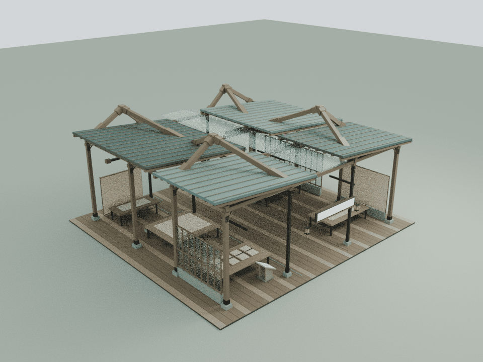
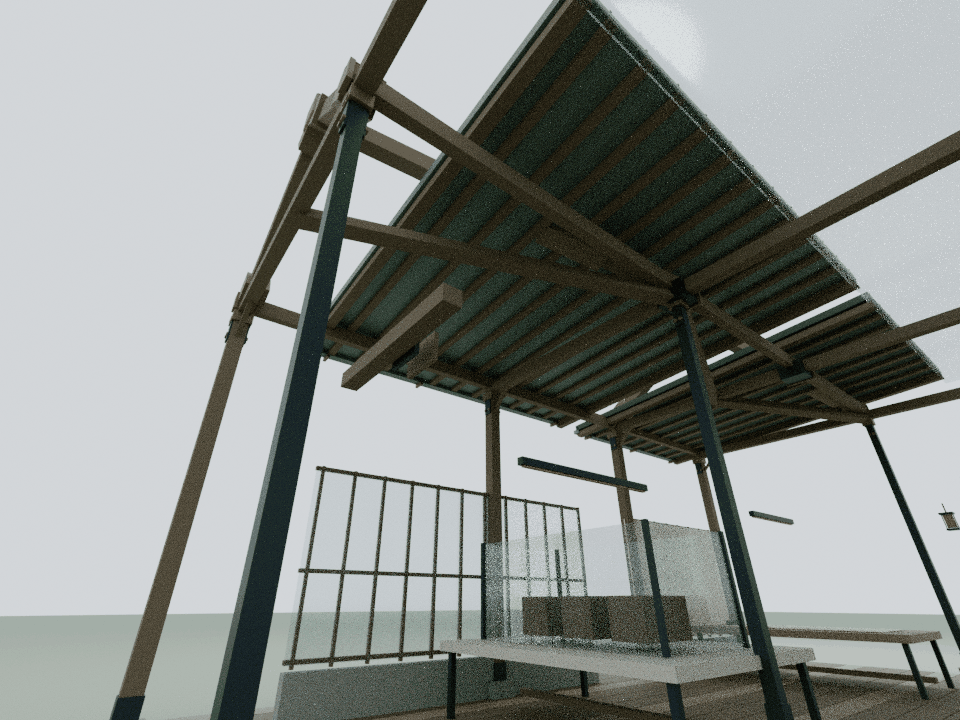
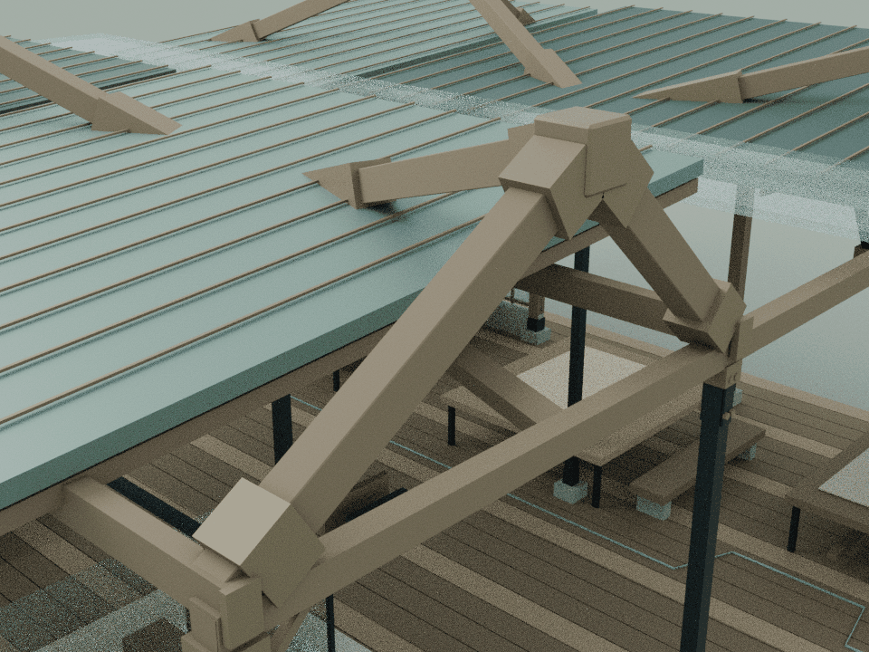

# GitHub 工坊：可检查的分支与套接

本轮只细化 building25「GitHub · Lx050」，基于已发布的 `be0e5ad14a8a2c6c7600af9566a33e45ee4f12e4`。依据仓库已复核的 `assets/readings/25.json`：纸墨工具、编辑资产、文化研究与原生应用形成互相连接的项目方向；fork 有上游来源，公开可读与允许复用也有各自边界。

## 内容与构造

原建筑已有分支梁、不同工位、透明检查区、独立套接的研读附室和一个可拆检接头。本轮以外露木桁架和可见套接节点加强这套工坊结构，使分支与接续成为清楚的建筑轮廓。原屋面和工位保持，中央路线不设新的高台、楼梯或装饰障碍。

原小接头继续移动0.46 m，露出既有连接与紧固件。这个动作解释“可以查看连接”，不代表对真实仓库执行过构建或代码验收。项目名称、来源与许可说明保持，不新增星标计数、贡献排行、绿色成功灯，也不把上游 fork 改称独立原创。

## 模型与重建

    blender -b -t 2 --python tools/model-workshop.py
    node docs/workshop-detail-check.cjs
    node docs/workshop-regression.cjs
    node docs/detail-lod-check.cjs
    blender -b -t 4 --python tools/render-workshop.py

本轮为12根外露雪松分支杆、4个抬高的三向节点和24个有真实贯穿孔的铜色套筒，共40个闭合实体、1,472三角面、2个静态材质批次。两侧各有前后两个分叉节点，最高点9.50 m；原模块屋面仍在，不增加整片遮盖。

实际 Blender 三角网格由 `assets/workshop-detail.js` 接入运行时，`assets/content-literary.js` 只在 building25 增加一个 `CourtyardWorkshopDetail.attach(b)`。采用完成原布局后挂入的方式，保留原 width/depth 与阅读位置，实际包围盒和高度包含新构件。

可编辑源与真实装配保留在 `qa-results/workshop/`，大模型不提交仓库；生成脚本、运行时网格和三张代表图提交。累计预算见 `DETAIL_PERFORMANCE_BUDGET.md`。

## 检查与限制

独立检查从实际运行时网格恢复实体，核对闭合性、尺寸、正体积连接与屋面落脚；同时核对原网格、材质、碰撞、文本、完整接头运动和连续通行净空。发布级回归检查其余建筑、机械蝶、发布哈希与缓存版本。

独立审计恢复40个朝外闭合流形实体，其中24个套筒具有真实贯穿孔；4,368条截面射线核对孔壁与留空。58处正体积连接使全部构件接入原建筑。完整旧屋面裁切核对10处穿出位置均落在实际套筒包覆内，构造修正覆盖了两处屋檐边缘擦穿。

577个原网格/实例及材质、文字、碰撞和动作在8个状态保持，7个章节与3个阅读相位的真实Canvas绘制保持。完整0.46 m接头运动保留至少25 mm新构件净空，完成7,360次三角检测；10段连续2.4 m身体净空完成101,280次三角及680次碰撞体检测。两个完整文字视域与各工位分别完成2,944和11,776次新构件检测。

整院49项CPU检查全部通过，70项发布manifest与49项入口缓存按实际SHA核验。102份JS/CJS、37份Python和34段HTML内联脚本语法通过。其余24栋标准馆、3项基础设施、25项原机制与114个保留资产通过隔离回归。累计17馆新增144,072三角面 / 129批次；本轮资产136,093字节原始 / 17,523字节gzip-9。

采用显式云端CPU检查列表，两个 Mac Chrome 导航脚本不执行，旧 wave1 哈希前置状态与本轮真实基线单独对照。以下为真实运行时装配的 Blender CPU 审阅图，Canvas 文字和纹理未烘焙；不能替代浏览器交互、GPU帧率或实体结构认证。

